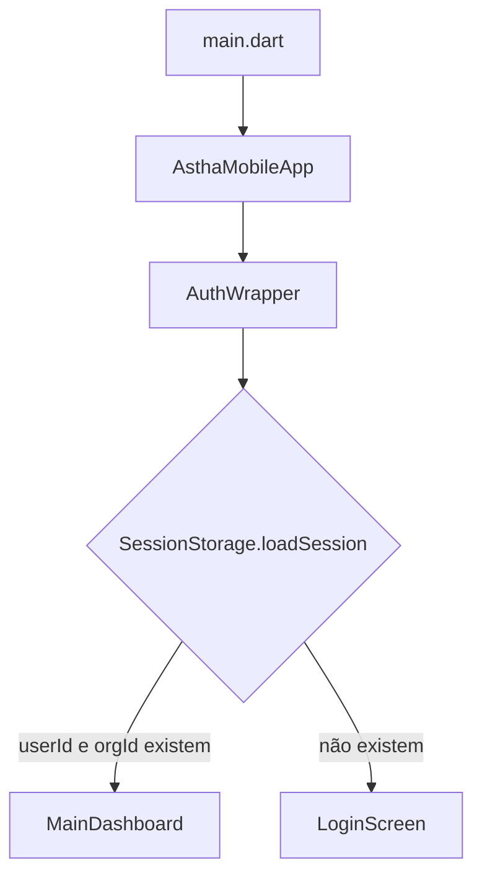
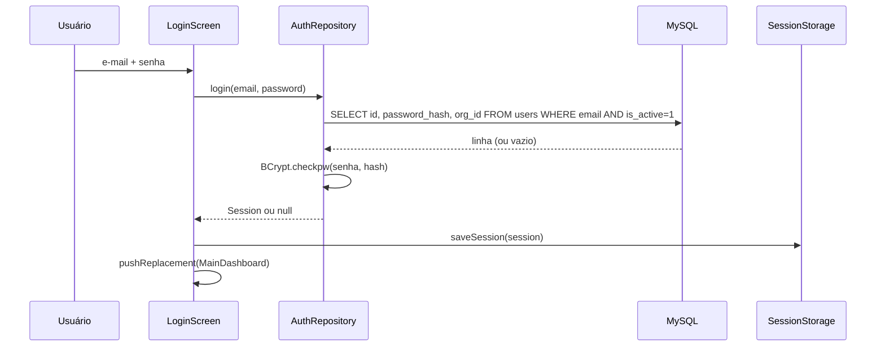

# ASTHA RAVEN: App Mobile (Flutter)

> **Pouco tempo (cerca de 12 horas no total)?** Vá direto à [seção 18 (Plano de execução em 12 horas)](#18-plano-de-execução-em-12-horas). O que não cabe nesse orçamento está no [backlog (seção 19)](#19-backlog-fora-das-12-horas), e as ideias de integração com o desktop estão na [seção 20](#20-integrações-sugeridas-com-o-app-desktop).

Documentação técnica para **continuar, manter e atualizar** o app mobile. Foi escrita como material de passagem de bastão: quem abrir o projeto pela primeira vez deve conseguir rodar, entender a arquitetura, achar onde mexer e saber o que ainda está pendente.

## Índice

1. [Escopo deste documento](#1-escopo-deste-documento)
2. [O que o app faz](#2-o-que-o-app-faz)
3. [Glossário](#3-glossário)
4. [Stack e dependências](#4-stack-e-dependências)
5. [Primeiros passos (onboarding)](#5-primeiros-passos-onboarding)
6. [Arquitetura](#6-arquitetura)
7. [Fluxos principais](#7-fluxos-principais)
8. [Referência de arquivos](#8-referência-de-arquivos)
9. [Banco de dados](#9-banco-de-dados)
10. [Sessão e armazenamento local](#10-sessão-e-armazenamento-local)
11. [Tratamento de erros](#11-tratamento-de-erros)
12. [Convenções de código](#12-convenções-de-código)
13. [Receitas: como fazer mudanças comuns](#13-receitas-como-fazer-mudanças-comuns)
14. [Testes](#14-testes)
15. [Atualização de dependências](#15-atualização-de-dependências)
16. [Build e release](#16-build-e-release)
17. [Segurança: pendências conhecidas](#17-segurança-pendências-conhecidas)
18. [Plano de execução em 12 horas](#18-plano-de-execução-em-12-horas)
19. [Backlog (fora das 12 horas)](#19-backlog-fora-das-12-horas)
20. [Integrações sugeridas com o app desktop](#20-integrações-sugeridas-com-o-app-desktop)
21. [Solução de problemas](#21-solução-de-problemas)
22. [Fluxo de trabalho com Git e checklist de PR](#22-fluxo-de-trabalho-com-git-e-checklist-de-pr)
23. [Pontos a confirmar com quem desenvolveu antes](#23-pontos-a-confirmar-com-quem-desenvolveu-antes)

---

## 1. Escopo deste documento

Este README descreve **apenas o app mobile Flutter**, na versão **modularizada**. Essa versão é uma refatoração de um `main.dart` único que concentrava telas, SQL, tema e acesso ao banco.

O repositório original tem outras partes que **não estão cobertas aqui** porque não foram analisadas: web app (core), site, app desktop, pasta de banco de dados e a integração FaceTec. Se alguma delas compartilha o banco ou regras de negócio com o mobile, confirme com o responsável antes de alterar esquema ou semântica de dados (veja a seção 23).

Onde este documento diz "inferido do código", significa que a informação foi deduzida das consultas SQL e das telas, e **não** de um esquema oficial. Confira com o banco real.

---

## 2. O que o app faz

| Funcionalidade | Descrição |
|---|---|
| Login | E-mail e senha. A senha é conferida com bcrypt contra `users.password_hash`. Só entram usuários com `is_active = 1`. |
| Configuração de servidor | Na tela de login, o ícone de engrenagem permite trocar o host do banco. O valor fica salvo no aparelho. |
| Estoque | Lista os materiais da organização do usuário, com código, descrição, armazém, quantidade e imagem. |
| Movimentações | Lista as últimas 50 entradas e saídas da organização, com quem fez e quando. |
| Scanner | Lê o QR Code (que contém o **código do material**), pergunta quantidade e tipo (entrada ou saída), pede confirmação biométrica e registra no banco. |
| Perfil | Mostra e edita nome, sobrenome, telefone, data de nascimento, gênero e país. E-mail, empresa, setor e função são somente leitura. |
| Logout | Apaga a sessão local e volta ao login. |

**Multi-organização:** todo dado de estoque é filtrado por `org_id`, que vem do usuário logado. É o único isolamento entre organizações (veja a seção 17 sobre por que isso é frágil hoje).

---

## 3. Glossário

| Termo | Significado |
|---|---|
| **Organização (`org_id`)** | Empresa/cliente dona dos dados. Cada usuário pertence a uma. |
| **Material** | Item de estoque, identificado por `code` (o que vai no QR Code). |
| **Armazém (warehouse)** | Local físico onde o material está. |
| **Movimentação** | Registro de `entrada` (soma ao estoque) ou `saida` (subtrai). |
| **Sessão** | Conjunto `userId` + `orgId` + `dbHost` guardado no aparelho. |
| **Repositório** | Classe que concentra o acesso a dados de um assunto (SQL fica só nelas). |
| **Model** | Classe imutável que representa uma linha do banco ou um dado de tela. |
| **Feature** | Pasta que agrupa uma tela e seus widgets internos. |

---

## 4. Stack e dependências

| Pacote | Para que serve | Onde é usado |
|---|---|---|
| `flutter` (Material) | UI | todo o app |
| `mysql_client` | Conexão e consultas ao MySQL | `core/database`, `models/*` (tipo `ResultSetRow`) |
| `bcrypt` | Verificar o hash da senha | `repositories/auth_repository.dart` |
| `shared_preferences` | Guardar sessão e host | `core/storage/session_storage.dart` |
| `mobile_scanner` | Leitura de QR Code pela câmera | `features/scanner/scanner_screen.dart` |
| `local_auth` | Confirmação biométrica | `features/scanner/scanner_screen.dart` |

Requisito de linguagem: o código usa **records** do Dart 3 (em `AuthWrapper`). O `pubspec.yaml` deve ter `sdk: ">=3.0.0 <4.0.0"` ou superior. Também usa `firstOrNull` (Dart 3).

Fonte `Inter`: o tema referencia `fontFamily: 'Inter'`. Confirme se a fonte está declarada no `pubspec.yaml` (seção `fonts`). Se não estiver, o Flutter usa a fonte padrão sem dar erro.

Asset `assets/images/app_icon.png`: usado na tela de login. Se faltar, aparece um ícone de erro (há `errorBuilder`).

---

## 5. Primeiros passos (onboarding)

1. Instale o Flutter e rode `flutter doctor` até ficar sem pendências para Android.
2. Clone o repositório e entre na pasta do app.
3. Peça ao responsável as credenciais do banco **de desenvolvimento** (não use as de produção).
4. Crie o arquivo local `env.json` (não versionar):

   ```json
   {
     "DB_HOST": "...",
     "DB_PORT": "3306",
     "DB_USER": "...",
     "DB_PASSWORD": "...",
     "DB_NAME": "..."
   }
   ```

5. Garanta que o `.gitignore` contém:

   ```
   env.json
   *.jks
   key.properties
   ```

6. Rode:

   ```bash
   flutter pub get
   flutter run --dart-define-from-file=env.json
   ```

7. Faça login com um usuário de teste e percorra: estoque, movimentações, perfil, scanner e logout.

> A câmera e a biometria funcionam melhor em **aparelho físico**. No emulador, o scanner pode não ter imagem e a biometria depende de configuração do emulador.

Comandos do dia a dia:

```bash
flutter analyze            # análise estática
dart format lib            # formatação
flutter test               # testes
flutter clean              # limpa cache de build
flutter pub outdated       # pacotes desatualizados
```

---

## 6. Arquitetura

### 6.1 Camadas

```
┌───────────────────────────────────────────────┐
│ features/   (telas e widgets de cada tela)    │
└──────────────┬────────────────────────────────┘
               │ chama
┌──────────────▼────────────────────────────────┐
│ repositories/   (SQL e regras de acesso)      │
└──────────────┬────────────────────────────────┘
               │ usa
┌──────────────▼────────────────────────────────┐
│ core/database/DatabaseService   (conexão)     │
└───────────────────────────────────────────────┘

models/   → usados por todas as camadas acima
core/     → tema, config, storage e widgets compartilhados
```

### 6.2 Regras de dependência (respeite ao crescer o código)

- `features/` pode importar `repositories/`, `models/` e `core/`.
- `repositories/` pode importar `models/` e `core/database`. **Nunca** importa `features/`.
- `models/` não importa nada além de `mysql_client` (para `fromRow`) e `dart:*`.
- `core/` não importa `features/` nem `repositories/`. (Exceção atual: `session_storage.dart` importa `models/session.dart`, o que é aceitável.)
- Uma feature **não importa outra feature**, exceto navegação: `auth` → `dashboard`, `dashboard` → `stock`, `profile`, `scanner`, e `profile` → `auth` (logout).

### 6.3 Injeção de dependência

Não há framework de DI nem gerenciador de estado (Provider, Riverpod, Bloc). Hoje:

- A `Session` é passada por construtor de tela em tela.
- Cada tela cria seu repositório com `XRepository(DatabaseService(session.dbHost))`.
- O estado local usa `StatefulWidget` + `setState`.

Isso é simples e suficiente para o tamanho atual. Se o app crescer (mais telas, cache, vários repositórios por tela), considere Provider ou Riverpod para expor `Session` e repositórios (veja a seção 19).

### 6.4 Navegação

Usa `Navigator` com `MaterialPageRoute` e `pushReplacement` entre login e dashboard. Não há rotas nomeadas. Troca de abas do dashboard é por `setState` no índice (não preserva o estado das abas ao trocar; para preservar, use `IndexedStack`).

---

## 7. Fluxos principais

### 7.1 Inicialização



`AuthWrapper` lê `userId`, `orgId` e `dbHost` do `SharedPreferences`. Se `userId` e `orgId` existirem, vai direto ao dashboard **sem revalidar nada no servidor**.

### 7.2 Login



Pontos de atenção:
- `null` = credenciais inválidas (a tela mostra "Email ou senha incorretos.", sem diferenciar e-mail inexistente de senha errada, o que é intencional).
- Exceção = falha de banco ou rede (a tela mostra "Erro DB: ...").

### 7.3 Registro de movimentação (scanner)

```mermaid
sequenceDiagram
  participant C as Câmera
  participant S as ScannerScreen
  participant D as QuantityDialog
  participant A as local_auth
  participant R as MovementRepository
  participant DB as MySQL
  C->>S: onDetect(código)
  S->>S: _isProcessing = true
  S->>D: showQuantityDialog(código)
  D-->>S: ScanAction(tipo, qtd) ou null
  S->>A: authenticate()
  A-->>S: ok / cancelado
  S->>R: register(code, orgId, userId, type, qty)
  R->>DB: SELECT id FROM materials WHERE code AND org_id
  R->>DB: BEGIN; UPDATE materials; INSERT INTO movements; COMMIT
  R-->>S: sucesso (ou MaterialNotFoundException)
  S->>S: snackbar + pop()
```

Detalhes:
- `_isProcessing` evita que a câmera dispare várias leituras seguidas enquanto o diálogo está aberto.
- A atualização do estoque e o `INSERT` do histórico acontecem **na mesma transação** (`conn.transactional`). Ou ocorrem os dois, ou nenhum.
- Se o aparelho não suporta biometria, `_confirmIdentity()` retorna `true` e a ação segue sem confirmação (veja a seção 17).
- Ao voltar para o dashboard, `_stockVersion` é incrementado e a `StockTab` é recriada via `ValueKey`, o que recarrega as listas.

### 7.4 Perfil

1. `ProfileTab` chama `ProfileRepository.fetch(userId)` no `initState`.
2. Preenche os controllers dos campos editáveis e guarda o `UserProfile` para os campos somente leitura.
3. "Salvar alterações" chama `ProfileRepository.update(userId, EditableProfile)`. Só os seis campos editáveis são enviados.

### 7.5 Logout

`SessionStorage.clearSession()` remove `userId` e `orgId` (mantém `dbHost` de propósito, para o próximo login) e leva ao `LoginScreen`.

---

## 8. Referência de arquivos

### 8.1 Raiz de `lib/`

| Arquivo | Responsabilidade |
|---|---|
| `main.dart` | Ponto de entrada. Inicializa o binding, define o estilo da barra de status e chama `runApp`. |
| `app.dart` | `AsthaMobileApp`: `MaterialApp` com título, tema e `home: AuthWrapper`. |

### 8.2 `core/`

| Arquivo | Responsabilidade |
|---|---|
| `config/app_config.dart` | Lê `DB_HOST`, `DB_PORT`, `DB_USER`, `DB_PASSWORD`, `DB_NAME` de `String.fromEnvironment`. Valores vêm do `--dart-define`. |
| `database/database_service.dart` | `DatabaseService(host).run((conn) async {...})`: abre a conexão, executa a ação e **sempre fecha** (`finally`). Todo acesso ao banco passa por aqui. |
| `storage/session_storage.dart` | Lê e grava `userId`, `orgId`, `dbHost` no `SharedPreferences`. Métodos: `loadSession`, `saveSession`, `clearSession`, `loadDbHost`, `saveDbHost`. |
| `theme/app_colors.dart` | Constantes de cor (inclui `success`, `danger`, `overlay`, etc.). |
| `theme/app_theme.dart` | `AppTheme.light`: `ThemeData` do app. |
| `widgets/app_snackbar.dart` | `AppSnackBar.success(context, msg)` e `.error(context, msg)`. Já checa `context.mounted`. |
| `widgets/rounded_text_field.dart` | Campo com borda arredondada (login). |
| `widgets/async_list_view.dart` | `AsyncListView<T>`: recebe um `loader`, mostra loading, erro, estado vazio e lista com *pull-to-refresh*. |

### 8.3 `models/`

| Arquivo | Classe(s) | Observações |
|---|---|---|
| `session.dart` | `Session` | `userId`, `orgId`, `dbHost` (todos `String`). |
| `material_item.dart` | `MaterialItem` | `fromRow` espera: `code, description, quantity, warehouse, image_url` (nessa ordem). |
| `movement_item.dart` | `MovementType`, `MovementItem` | `fromRow` espera: `description, type, quantity, created_at, user name`. `formattedDate` remove os milissegundos. |
| `user_profile.dart` | `UserProfile`, `EditableProfile` | `UserProfile` é a leitura completa; `EditableProfile` são os campos que podem ser gravados. |

> **Atenção à ordem das colunas:** os `fromRow` usam `row.colAt(índice)`. Se alterar a ordem do `SELECT` no repositório, **tem que alterar o `fromRow` junto**, senão os campos trocam de lugar sem erro de compilação.

### 8.4 `repositories/`

| Arquivo | Métodos | SQL (resumo) |
|---|---|---|
| `auth_repository.dart` | `login({email, password})` → `Session?` | `SELECT ... FROM users WHERE email = :email AND is_active = 1` |
| `material_repository.dart` | `listByOrg(orgId)` → `List<MaterialItem>` | `materials` com `LEFT JOIN warehouses`, filtrado por `org_id`, ordenado por descrição |
| `movement_repository.dart` | `historyByOrg(orgId, {limit = 50})`, `register(...)` | histórico: `movements JOIN materials LEFT JOIN users`; registro: `SELECT id`, `UPDATE materials`, `INSERT INTO movements` em transação |
| `profile_repository.dart` | `fetch(userId)` → `UserProfile?`, `update(userId, EditableProfile)` | `SELECT`/`UPDATE` em `users` por `id` |

`MaterialNotFoundException` (em `movement_repository.dart`) é lançada quando o código lido no QR não existe na organização do usuário.

### 8.5 `features/`

| Pasta | Arquivos | Responsabilidade |
|---|---|---|
| `auth/` | `auth_wrapper.dart`, `login_screen.dart`, `widgets/db_host_dialog.dart` | Decide entre login e dashboard; formulário de login; diálogo de host do banco. |
| `dashboard/` | `main_dashboard.dart` | Contêiner com barra inferior (Estoque, Perfil) e botão flutuante "Escanear". Controla `_stockVersion` para recarregar o estoque. |
| `stock/` | `stock_tab.dart`, `widgets/material_tile.dart`, `widgets/movement_tile.dart` | Duas abas (Materiais e Movimentações) usando `AsyncListView`. |
| `profile/` | `profile_tab.dart` | Edição do perfil e logout. Contém `_EditableField` e `_ReadOnlyField` (privados). |
| `scanner/` | `scanner_screen.dart`, `widgets/quantity_dialog.dart` | Leitura do QR, diálogo de quantidade, biometria e registro. `ScanAction` (tipo + quantidade) é o resultado do diálogo. |

---

## 9. Banco de dados

### 9.1 Tabelas e colunas usadas (inferido do código)

Os tipos abaixo são **presumidos**. Confira com o esquema real antes de qualquer migração.

**`users`**

| Coluna | Tipo presumido | Uso |
|---|---|---|
| `id` | INT (PK) | identificação; vai para `movements.created_by` |
| `email` | VARCHAR | login |
| `password_hash` | VARCHAR | hash bcrypt |
| `is_active` | TINYINT(1) | só `1` pode logar |
| `org_id` | INT | organização do usuário |
| `name`, `surname` | VARCHAR | editáveis |
| `phone` | VARCHAR | editável |
| `dob` | DATE ou VARCHAR | editável; o app trata como texto |
| `gender`, `country` | VARCHAR | editáveis |
| `company`, `role`, `sector` | VARCHAR | somente leitura no app |

**`materials`**

| Coluna | Tipo presumido | Uso |
|---|---|---|
| `id` | INT (PK) | |
| `code` | VARCHAR | valor do QR Code |
| `description` | VARCHAR | |
| `quantity` | INT | saldo atual |
| `warehouse_id` | INT (FK) | liga a `warehouses.id` |
| `org_id` | INT | isolamento por organização |
| `image_url` | VARCHAR | opcional |

**`warehouses`**: `id`, `name`.

**`movements`**

| Coluna | Tipo presumido | Uso |
|---|---|---|
| `id` | INT (PK) | |
| `material_id` | INT (FK) | liga a `materials.id` |
| `type` | VARCHAR ou ENUM | `'entrada'` ou `'saida'` |
| `quantity` | INT | sempre positivo; o sinal vem do `type` |
| `created_by` | INT (FK) | liga a `users.id` |
| `created_at` | DATETIME | provavelmente preenchido por default no banco |

### 9.2 Consultas e índice das colunas

Útil para alterar um `SELECT` sem quebrar o `fromRow`.

| Consulta | Índices (`colAt`) |
|---|---|
| Login | 0 `id`, 1 `password_hash`, 2 `org_id` |
| Materiais | 0 `code`, 1 `description`, 2 `quantity`, 3 `w.name`, 4 `image_url` |
| Histórico | 0 `m.description`, 1 `type`, 2 `quantity`, 3 `created_at`, 4 `u.name` |
| Perfil | 0 `name`, 1 `surname`, 2 `email`, 3 `phone`, 4 `company`, 5 `role`, 6 `sector`, 7 `dob`, 8 `gender`, 9 `country` |

### 9.3 Índices e desempenho (sugestão)

Para as consultas atuais ajudam: índice em `users(email)`, `materials(org_id, code)`, `materials(org_id, description)` e `movements(material_id, created_at)`. Valide com `EXPLAIN` no banco real.

### 9.4 Observações técnicas sobre as consultas

- O `mysql_client` faz a substituição dos `:parametros` no cliente, com escape. Mesmo assim, **nunca concatene texto do usuário no SQL**.
- Em `MovementRepository.register`, o operador `+` ou `-` é inserido por interpolação (`$sign`). É seguro porque vem de um `enum` do próprio app, nunca de texto digitado. Não copie esse padrão para valores vindos do usuário.
- `quantity` é lido com `int.tryParse(...) ?? 0`. Valor nulo ou inválido vira `0` sem avisar.
- Toda operação abre e fecha uma conexão. Funciona, mas é custoso em rede móvel (veja a seção 19).

---

## 10. Sessão e armazenamento local

Chaves em `SharedPreferences` (definidas em `SessionStorage`):

| Chave | Conteúdo | Apagada no logout? |
|---|---|---|
| `userId` | id do usuário (String) | sim |
| `orgId` | id da organização (String) | sim |
| `dbHost` | host do banco | não (de propósito) |

Hoje **não há token nem expiração de sessão**. Quem tem `userId` e `orgId` salvos entra direto. Veja a seção 17 (e o plano da seção 18).

---

## 11. Tratamento de erros

| Situação | Onde é tratada | O que o usuário vê |
|---|---|---|
| Campos vazios no login | `LoginScreen._login` | "Preencha os dados." |
| Credenciais inválidas | `AuthRepository` devolve `null` | "Email ou senha incorretos." |
| Falha de banco/rede | `catch` na tela | "Erro DB: <detalhe>" |
| Material inexistente | `MaterialNotFoundException` | "Material não encontrado!" |
| Biometria cancelada | `ScannerScreen._processItem` | "Cancelado" |
| Erro ao carregar listas | `AsyncListView` | "Erro DB: <detalhe>" no centro da tela |
| Erro ao carregar perfil | `ProfileTab._load` | nada (só `debugPrint`) |

Padrões a seguir ao criar código novo:
- Repositórios **lançam exceções**; as telas capturam e mostram a mensagem.
- Mensagens de erro técnicas (`Erro DB: ...`) expõem detalhes do servidor ao usuário. Em produção, troque por uma mensagem genérica e registre o detalhe em log.
- Use `AppSnackBar` para feedback, nunca `ScaffoldMessenger` direto.

---

## 12. Convenções de código

- **Nomes de arquivo:** `snake_case.dart`. Uma classe pública principal por arquivo.
- **Classes privadas de uso único** (por exemplo, `_EditableField`) ficam no mesmo arquivo da tela.
- **Imports relativos** dentro de `lib/`, ordenados: `dart:`, `package:`, relativos.
- **`const`** em todo widget e construtor possível (o `flutter analyze` aponta).
- **Formatação:** `dart format lib` antes de cada commit.
- **Comentários:** explique o *porquê*, não o *quê*. Use `///` em classes e métodos públicos.
- **Textos da interface** estão em português e escritos direto no código (sem internacionalização). Se for preciso suportar outro idioma, migre para `flutter_localizations` e arquivos `.arb`.
- **Dinheiro e quantidades:** sempre `int`. Não use `double` para saldo de estoque.
- **Contexto após `await`:** sempre `if (!mounted) return;` (em `State`) ou `context.mounted`.

---

## 13. Receitas: como fazer mudanças comuns

### 13.1 Adicionar um campo ao perfil (exemplo: `cargo_anterior`)

1. **Model**, `models/user_profile.dart`:
   - Adicione `final String previousRole;` em `UserProfile`.
   - Em `fromRow`, acrescente `previousRole: row.colAt(10) ?? ''`. O índice 10 é o próximo livre, desde que você coloque a coluna **no fim** do `SELECT`.
   - Se for editável, acrescente também em `EditableProfile`.
2. **Repositório**, `repositories/profile_repository.dart`:
   - Inclua a coluna no fim do `SELECT`.
   - Se for editável, inclua no `UPDATE` e no mapa de parâmetros.
3. **Tela**, `features/profile/profile_tab.dart`:
   - Novo `TextEditingController` (com `dispose()`), preenchimento em `_load`, e um `_EditableField` (ou `_ReadOnlyField`).
   - Se for editável, inclua no `EditableProfile(...)` dentro de `_save`.
4. Rode `flutter analyze` e teste leitura e gravação.

### 13.2 Adicionar uma consulta nova (exemplo: materiais com estoque baixo)

```dart
// repositories/material_repository.dart
Future<List<MaterialItem>> lowStock(String orgId, {int threshold = 5}) {
  return _db.run((conn) async {
    final results = await conn.execute(
      'SELECT m.code, m.description, m.quantity, w.name, m.image_url '
      'FROM materials m LEFT JOIN warehouses w ON m.warehouse_id = w.id '
      'WHERE m.org_id = :orgId AND m.quantity <= :t '
      'ORDER BY m.quantity ASC',
      {'orgId': orgId, 't': threshold},
    );
    return results.rows.map(MaterialItem.fromRow).toList();
  });
}
```

Reaproveitar o mesmo `SELECT` (mesma ordem de colunas) permite reaproveitar `MaterialItem.fromRow`.

### 13.3 Adicionar uma tela nova (exemplo: lista de armazéns)

1. `models/warehouse.dart`: classe `Warehouse` com `fromRow`.
2. `repositories/warehouse_repository.dart`: método `list(orgId)`.
3. `features/warehouses/warehouses_screen.dart`: use `AsyncListView<Warehouse>` (já traz loading, erro, vazio e refresh).
4. Navegação: um item novo no `BottomNavigationBar` de `main_dashboard.dart` (e um novo ramo no `body`), ou `Navigator.push` a partir de outro lugar.

### 13.4 Adicionar uma aba nova ao dashboard

Em `main_dashboard.dart`:
- Acrescente o `BottomNavigationBarItem`.
- Troque o `body` condicional por um `switch` (ou, preferencialmente, por um `IndexedStack` para manter o estado das abas).

### 13.5 Mudar o visual

- Cores: somente `core/theme/app_colors.dart`.
- Tema global (AppBar, fonte): `core/theme/app_theme.dart`.
- Tema escuro: crie `AppTheme.dark` e configure `darkTheme` e `themeMode` em `app.dart`. Hoje várias telas usam `Colors.white` fixo e precisariam ser ajustadas.

### 13.6 Trocar o acesso direto ao MySQL por uma API (migração recomendada)

A estrutura foi pensada para isso: **só a camada `repositories/` muda**, as telas não.

1. Crie uma classe `ApiClient` em `core/network/` (pacote `dio` ou `http`) que guarda a URL base e o token.
2. Para cada repositório, extraia uma interface (`abstract class MaterialRepository`) e crie duas implementações: `MySqlMaterialRepository` (atual) e `ApiMaterialRepository` (novo).
3. Faça o login retornar um **token** (JWT ou similar) em vez de depender de `userId` e `orgId` locais; guarde-o com `flutter_secure_storage`.
4. O servidor deve aplicar o filtro de `org_id` **a partir do token**, não de um parâmetro enviado pelo app.
5. Remova `mysql_client`, `bcrypt` e `AppConfig.db*` do app; o MySQL deixa de ser acessível pela internet.

### 13.7 Pedir confirmação por PIN quando não há biometria

Em `ScannerScreen._confirmIdentity()`, o ramo `if (!canAuth) return true;` é o ponto a alterar. Decida a política (bloquear a ação, pedir senha do app, etc.) e implemente ali.

---

## 14. Testes

Hoje **não há testes** no projeto. Sugestão de por onde começar, do mais barato ao mais caro:

1. **Models** (`fromRow`): teste unitário com linhas simuladas. É onde mais dói errar o índice de coluna.
2. **Repositórios:** o ideal é depender de uma interface em vez de `DatabaseService` concreto, para trocar por um *fake* no teste. Enquanto isso não existe, use um banco de teste real.
3. **Widgets:** `testWidgets` para `QuantityDialog` (incrementar, decrementar e retorno do `ScanAction`) e `AsyncListView` (loading, erro, vazio, lista).

Exemplo de teste de widget para o diálogo:

```dart
testWidgets('quantidade não desce abaixo de 1', (tester) async {
  await tester.pumpWidget(MaterialApp(
    home: Builder(
      builder: (context) => ElevatedButton(
        onPressed: () => showQuantityDialog(context, 'ABC'),
        child: const Text('abrir'),
      ),
    ),
  ));
  await tester.tap(find.text('abrir'));
  await tester.pumpAndSettle();

  await tester.tap(find.byIcon(Icons.remove_circle_outline));
  await tester.pump();
  expect(find.text('1'), findsOneWidget);
});
```

Rodar: `flutter test`. Para cobertura: `flutter test --coverage`.

Roteiro de teste manual antes de cada release:
- [ ] Login com usuário válido, inválido e inativo
- [ ] Trocar host na engrenagem e logar
- [ ] Estoque carrega e o *pull-to-refresh* funciona
- [ ] Movimentações mostram usuário e data
- [ ] Scanner: entrada, saída, código inexistente, cancelar diálogo, cancelar biometria
- [ ] Estoque atualiza ao voltar do scanner
- [ ] Perfil: editar, salvar, reabrir e conferir persistência
- [ ] Logout e reabrir o app (deve cair no login)
- [ ] Sem internet: mensagens de erro aparecem e o app não trava

---

## 15. Atualização de dependências

```bash
flutter pub outdated                      # o que está desatualizado
flutter pub upgrade                       # dentro das restrições do pubspec
flutter pub upgrade --major-versions      # versões maiores (pode quebrar)
flutter analyze && flutter test
```

Boas práticas:
- Em versão maior, atualize **um pacote por vez** e leia o *changelog* no pub.dev.
- `mobile_scanner` e `local_auth` dependem de código nativo e permissões. Depois de subir versão maior, confira `android/app/src/main/AndroidManifest.xml`, `minSdkVersion` em `android/app/build.gradle` e (no iOS) o `Info.plist`.
- `mysql_client` e `bcrypt` não têm relação com plataforma, mas mudanças de API (por exemplo, assinatura de `execute` ou `transactional`) quebram os repositórios. Os pontos de uso são poucos e concentrados em `repositories/` e `core/database/`.
- Atualização do Flutter: `flutter upgrade`, depois `flutter pub get`, `flutter analyze` e teste manual completo.
- Ative o **Dependabot** no GitHub para receber avisos de vulnerabilidade em dependências.

---

## 16. Build e release

### 16.1 Comandos

```bash
# APK para distribuição direta
flutter build apk --release --dart-define-from-file=env.json

# Bundle para a Play Store
flutter build appbundle --release --dart-define-from-file=env.json
```

Saídas: `build/app/outputs/flutter-apk/app-release.apk` e `build/app/outputs/bundle/release/app-release.aab`.

### 16.2 Versão

Em `pubspec.yaml`: `version: 1.0.1+2`. A parte antes do `+` é a versão exibida; o número depois é o *build number* e **só pode aumentar** (a Play Store rejeita repetido).

### 16.3 Assinatura

- Use uma *keystore* de release guardada **fora do repositório** (com backup seguro; perder a keystore impede atualizar o app na loja).
- Configure `android/key.properties` (no `.gitignore`) e referencie em `android/app/build.gradle`.

### 16.4 Permissões e requisitos nativos (confirmar no projeto)

| Pacote | Android | iOS |
|---|---|---|
| `mobile_scanner` | permissão `CAMERA` | `NSCameraUsageDescription` no `Info.plist` |
| `local_auth` | permissão `USE_BIOMETRIC`; a `MainActivity` deve estender `FlutterFragmentActivity` | `NSFaceIDUsageDescription` no `Info.plist` |
| Rede | permissão `INTERNET` (já vem no build de debug; **confirme no manifest de release**) | tráfego pela porta 3306 para o servidor |

Sem a permissão `INTERNET` no manifesto principal, o app de release não acessa a rede.

### 16.5 Antes de cada release

1. Atualize a versão no `pubspec.yaml`.
2. `flutter analyze` sem erros e teste manual em aparelho físico.
3. Gere o build assinado.
4. **Não versione APKs no Git.** Use a aba *Releases* do GitHub ou outra forma de distribuição.
5. Registre as mudanças em um `CHANGELOG.md`.

---

## 17. Segurança: pendências conhecidas

Esta é a seção mais importante para quem vai continuar o código. A última coluna indica o que cabe no plano de 12 horas (seção 18) e o que precisa ir para o backlog (seção 19).

| Prioridade | Problema | Por que importa | O que fazer | Cabe em 12h? |
|---|---|---|---|---|
| **Crítica** | Usuário, senha e IP do MySQL estiveram escritos no código e podem estar no histórico do Git | Quem tem acesso ao repositório (público) ou a um APK antigo consegue acessar o banco | Trocar a senha (idealmente criar um usuário novo com privilégios mínimos); limpar o histórico com `git filter-repo` ou BFG | **Sim** (troca: ~1h; limpeza do histórico: ~1h) |
| **Alta** | O app conecta direto ao MySQL; as credenciais ficam dentro do APK | Qualquer pessoa extrai as credenciais do binário e acessa o banco, ignorando login e `org_id` | Criar uma API com autenticação por token e fechar o MySQL para a internet (seção 13.6) | **Não** (1 a 2 semanas). **Mitigação no plano:** usuário MySQL com privilégios mínimos |
| **Alta** | Sessão em `SharedPreferences`, sem criptografia e sem token | Editar `userId`/`orgId` no aparelho permite agir como outro usuário ou organização | `flutter_secure_storage` + token do servidor, com expiração | **Não** (depende da API). **Mitigação no plano:** revalidar a sessão ao abrir o app |
| **Média** | Saída de estoque não verifica saldo | A quantidade pode ficar negativa | `UPDATE ... AND quantity >= :qty` e conferir linhas afetadas | **Sim** |
| **Média** | Sem biometria/bloqueio de tela no aparelho, a confirmação é ignorada | Ação sensível sem nenhuma confirmação | Exigir bloqueio de tela ou biometria | **Sim** (depende de decisão de produto) |
| **Média** | Sessão nunca é revalidada | Usuário desativado (`is_active = 0`) continua usando o app | Revalidar no servidor ao abrir o app | **Sim** |
| **Média** | Conexão ao MySQL provavelmente sem TLS | Dados e credenciais trafegam em texto | TLS no MySQL ou, melhor, API sobre HTTPS | **Não** (depende do servidor e da API) |
| **Baixa** | Mensagens `Erro DB: ...` mostram detalhes do servidor | Vazam informação interna | Mensagem genérica na tela, detalhe em log | **Sim** |
| **Baixa** | Dados pessoais (data de nascimento, telefone) | Sujeitos à LGPD | Definir base legal, retenção e quem acessa | **Não** (decisão organizacional) |

Regras para qualquer código novo:
- Nunca escreva credenciais, tokens ou IPs de produção no código.
- Nunca concatene texto do usuário em SQL.
- Não confie em dados enviados pelo app para decidir permissões (por exemplo, `org_id`); isso deve ser decidido no servidor.

---

## 18. Plano de execução em 12 horas

**Resposta direta: mesmo com 12 horas, não cabe tudo.** A lista completa de pendências (API intermediária, sessão com token, TLS, modo offline, injeção de dependência, etc.) soma semanas de trabalho de uma pessoa. O que cabe em 12 horas é **conter o risco mais grave, corrigir os defeitos baratos, montar a rede de proteção (CI e testes), fazer uma integração mínima com o desktop e deixar o código pronto para a migração para API**. O resto está no backlog (seção 19).

**Como ler o orçamento.** As 12 horas são tempo efetivo, não necessariamente em um único dia. O plano usa **9h45 planejadas e ~2h15 de folga** (imprevistos, espera por acesso ao servidor, revisão). Está organizado em **4 sessões de 2 a 3h30**. Cada sessão termina com um PR que pode ser mesclado sozinho, então dá para pausar entre uma e outra com o código estável. Se for o seu primeiro contato com o repositório, tire 1 a 2 horas da folga para o onboarding (seção 5).

### 18.1 Antes de começar (perguntas que podem bloquear o plano)

1. **Quem tem acesso administrativo ao MySQL?** Sem isso, a tarefa T1 não acontece.
2. **O web app, o app desktop ou o site usam o mesmo usuário e a mesma senha do MySQL?** Se usarem, trocar a senha derruba todos até serem reconfigurados. Combine a troca com quem mantém essas partes.
3. **Qual a política de biometria?** Bloquear movimentações em aparelhos sem bloqueio de tela é uma decisão de produto (T8).
4. **Quem mantém o app desktop e pode revisar a integração (T14 e T15)?** Sem essa pessoa, essas duas tarefas ficam travadas.

### 18.2 Visão geral

| Sessão | Duração | Tarefas | Termina com |
|---|---|---|---|
| **1** | ~2h35 | T1, T2, T3, T4, T6 | Senha trocada, histórico limpo, erros genéricos. PR "Segurança básica" |
| **2** | ~2h | T5, T7, T8 | Saldo protegido, sessão revalidada, biometria obrigatória. PR "Integridade e acesso" |
| **3** | ~2h | T10, T11, T12, T13 | CI, testes mínimos, Dependabot, CHANGELOG. PR "Qualidade" |
| **4** | ~3h10 | T14, T15, T16 e fechamento | Contrato com o desktop, coluna `source`, build de verificação. PR "Integração desktop" |
| **Folga** | ~2h15 | imprevistos; se sobrar: T9, T17 | |
| **Total** | **12h** | **9h45 planejadas + 2h15 de folga** | |

Observações:
- **T6 vem antes de T5** porque cria as exceções do `core` que T5 usa. Por isso T6 está na sessão 1.
- Ao fim de cada sessão: `flutter analyze` e um teste de fumaça de 10 min (login, estoque, um registro no scanner). Esse tempo sai da folga.
- **Se atrasar, corte nesta ordem:** T12 → T4 → parte de T11 → T15. **Nunca corte T1.**
- T9 e T17 são **folga**: só entram se sobrar tempo.

### 18.3 Bloco 1: contenção de risco (2h05)

**T1. Trocar a senha do banco e reduzir privilégios (30 a 40 min)**

Prefira criar um usuário novo só para o app, com o mínimo necessário (em vez de só trocar a senha do usuário antigo). Execute como administrador, ajustando `<banco>` e a senha:

```sql
CREATE USER 'astha_app'@'%' IDENTIFIED BY '<senha-nova-forte>';
GRANT SELECT ON <banco>.users      TO 'astha_app'@'%';
GRANT UPDATE (name, surname, phone, dob, gender, country)
      ON <banco>.users             TO 'astha_app'@'%';
GRANT SELECT ON <banco>.materials  TO 'astha_app'@'%';
GRANT UPDATE (quantity)
      ON <banco>.materials         TO 'astha_app'@'%';
GRANT SELECT ON <banco>.warehouses TO 'astha_app'@'%';
GRANT SELECT, INSERT ON <banco>.movements TO 'astha_app'@'%';
```

Depois, **só depois de confirmar** que nenhuma outra parte do sistema usa o usuário antigo, troque a senha dele ou remova-o (`ALTER USER ... IDENTIFIED BY ...` ou `DROP USER`).

Limitações a ter claras:
- O app precisa de `SELECT` em `users`, então ele ainda consegue ler `password_hash`. Isso só se resolve com a API (seção 13.6).
- Se o servidor permitir, restrinja a origem do usuário (por exemplo, a um IP ou faixa) em vez de `'%'`. Aparelhos móveis têm IP variável, então talvez não seja viável.
- Instalações antigas do app, com a senha velha embutida, deixam de funcionar. Isso é desejável, mas avise os usuários e distribua o APK novo.

Atualize o `env.json` local com as novas credenciais e gere o novo build.

> **Pronto quando:** o app novo loga com o usuário `astha_app` e a senha antiga não funciona mais.

**T2. `.gitignore` e `env.json` (10 min)**

Garanta no `.gitignore`: `env.json`, `*.jks`, `*.keystore`, `key.properties`. Confira com `git status` que nada disso aparece como pendente de commit.

**T3. Parar de versionar binários e segredos (15 min)**

```bash
git ls-files | grep -E '\.(apk|aab|jks|keystore)$|env\.json|key\.properties'
git rm --cached <cada-arquivo-listado>
git commit -m "Remove binarios e segredos do rastreamento"
```

O repositório tem uma pasta de APK de release. Os binários devem ir para a aba *Releases* do GitHub, não para o código.

**T4. Limpar o histórico do Git (60 min)**

Só T1 elimina o risco real, porque o histórico já pode ter sido copiado (forks, clones, caches). Limpar o histórico é higiene adicional e **exige force push**, então combine com todos que têm clone.

1. Faça um backup: `git clone --mirror <url> raven-astha-backup.git`.
2. Em um clone novo, crie um arquivo `segredos.txt` (fora do repositório) com os valores vazados, um por linha, e rode `git filter-repo --replace-text segredos.txt`.
3. `git push --force --all` e `git push --force --tags`.
4. Peça que todos clonem de novo. Não façam `pull` sobre o clone antigo.

> **Pronto quando:** `git log -p -S'<trecho-da-senha-antiga>'` não retorna nada.

### 18.4 Bloco 2: correções de código (2h30)

**T5. Impedir saldo negativo (45 min)**

Em `core/errors/app_exceptions.dart` (arquivo novo, veja T6), crie `InsufficientStockException`. Em `repositories/movement_repository.dart`, troque o `UPDATE` dentro da transação:

```dart
await conn.transactional((txn) async {
  final update = await txn.execute(
    type == MovementType.entrada
        ? 'UPDATE materials SET quantity = quantity + :qty WHERE id = :id'
        : 'UPDATE materials SET quantity = quantity - :qty '
          'WHERE id = :id AND quantity >= :qty',
    {'qty': quantity, 'id': materialId},
  );
  if (update.affectedRows == BigInt.zero) {
    throw const InsufficientStockException();
  }
  await txn.execute(/* INSERT INTO movements ... (sem mudança) */);
});
```

Ao lançar a exceção dentro de `transactional`, a transação é desfeita e nada vai para `movements`. Confirme o tipo de `affectedRows` na versão instalada do `mysql_client` (aqui assumido `BigInt`).

> **Pronto quando:** uma saída maior que o saldo mostra "Estoque insuficiente." e **não** cria linha em `movements`.

**T6. Mensagens de erro genéricas (30 min)**

Mova `MaterialNotFoundException` para um arquivo do `core` (assim o `core` não depende de `repositories`) e crie um tradutor de erros:

```dart
// core/errors/app_exceptions.dart
abstract class AppException implements Exception {
  const AppException(this.message);
  final String message;
  @override
  String toString() => message;
}

class MaterialNotFoundException extends AppException {
  const MaterialNotFoundException() : super('Material não encontrado!');
}

class InsufficientStockException extends AppException {
  const InsufficientStockException() : super('Estoque insuficiente.');
}
```

```dart
// core/errors/friendly_error.dart
import 'dart:async';
import 'dart:io';
import 'package:flutter/foundation.dart';
import 'app_exceptions.dart';

String friendlyError(Object error) {
  debugPrint('Erro: $error'); // detalhe só no log
  if (error is AppException) return error.message;
  if (error is SocketException || error is TimeoutException) {
    return 'Sem conexão com o servidor. Verifique a rede.';
  }
  return 'Algo deu errado. Tente novamente.';
}
```

Substitua todos os `'Erro DB: $e'` e `'Erro: $e'` por `friendlyError(e)` em `login_screen.dart`, `async_list_view.dart`, `profile_tab.dart` e `scanner_screen.dart`. Ajuste os imports de `MaterialNotFoundException`.

> **Pronto quando:** `grep -rn "Erro DB" lib/` não retorna nada e, com a rede desligada, o app mostra "Sem conexão com o servidor."

**T7. Revalidar a sessão ao abrir o app (45 min)**

Em `AuthRepository`:

```dart
Future<bool> isSessionValid(Session s) => _db.run((conn) async {
      final r = await conn.execute(
        'SELECT 1 FROM users WHERE id = :id AND org_id = :org AND is_active = 1',
        {'id': s.userId, 'org': s.orgId},
      );
      return r.rows.isNotEmpty;
    });
```

Em `AuthWrapper._load()`:

```dart
Future<(Session?, String)> _load() async {
  var session = await _storage.loadSession();
  final host = session?.dbHost ?? await _storage.loadDbHost();
  if (session != null) {
    try {
      final repo = AuthRepository(DatabaseService(session.dbHost));
      if (!await repo.isSessionValid(session)) {
        await _storage.clearSession(); // desativado ou org adulterada
        session = null;
      }
    } catch (_) {
      session = null; // não deu para validar: pede login de novo
    }
  }
  return (session, host);
}
```

Isso bloqueia usuário desativado e a adulteração simples do `orgId`. **Não** impede trocar o `userId` por outro válido da mesma organização; isso só a sessão com token resolve (backlog).

> **Pronto quando:** desativar o usuário no banco e reabrir o app leva ao login.

**T8. Exigir confirmação de identidade (30 min, depende da decisão de produto)**

Em `ScannerScreen`, bloqueie a ação em aparelho sem bloqueio de tela ou biometria:

```dart
Future<bool> _confirmIdentity() async {
  if (!await _auth.isDeviceSupported()) return false;
  return _auth.authenticate(localizedReason: 'Confirme sua identidade.');
}
```

E no `_processItem`, troque a mensagem `'Cancelado'` por `'Confirmação de identidade necessária.'`, que cobre os dois casos (cancelou ou o aparelho não suporta). O `authenticate` padrão aceita biometria **ou** PIN/senha do aparelho.

> **Pronto quando:** num aparelho sem bloqueio de tela, a movimentação não é registrada.

### 18.5 Bloco 3: qualidade e processo (2h, mais T9 se houver folga)

**T9 (folga). `IndexedStack` no dashboard (20 min)**

Em `main_dashboard.dart`, troque o `body` condicional por um `IndexedStack(index: _currentIndex, children: [StockTab(key: ValueKey(_stockVersion), ...), ProfileTab(...)])`. Preserva o estado ao trocar de aba. Efeito colateral: o perfil passa a ser carregado já na abertura, com uma consulta a mais.

**T10. CI no GitHub Actions (30 min)**

Crie `.github/workflows/flutter.yml` na raiz do repositório. O app está dentro de uma pasta com espaços e parênteses, então use aspas no `working-directory`:

```yaml
name: Flutter CI
on:
  pull_request:
  push:
    branches: [main]
jobs:
  analyze-test:
    runs-on: ubuntu-latest
    defaults:
      run:
        working-directory: "MOBILE APP (FLUTTER)/APK RELEASE FACETEC/astha_mobile"
    steps:
      - uses: actions/checkout@v4
      - uses: subosito/flutter-action@v2
        with:
          channel: stable
          cache: true
      - run: flutter pub get
      - run: flutter analyze
      - run: flutter test
```

> **Pronto quando:** um PR de teste mostra o check verde (ou vermelho, se o `analyze` achar algo, e aí você corrige).

**T11. Testes mínimos (1h)**

Comece pelo que é barato e tem valor. Ajuste `astha_mobile` para o nome do pacote no `pubspec.yaml`.

```dart
// test/models/movement_item_test.dart
import 'package:flutter_test/flutter_test.dart';
import 'package:astha_mobile/models/movement_item.dart';

void main() {
  test('MovementType.fromString', () {
    expect(MovementType.fromString('entrada'), MovementType.entrada);
    expect(MovementType.fromString('qualquer'), MovementType.saida);
  });

  test('formattedDate remove os milissegundos', () {
    const item = MovementItem(
      description: 'x',
      type: MovementType.entrada,
      quantity: 1,
      date: '2026-10-13 10:00:00.000',
      userName: 'a',
    );
    expect(item.formattedDate, '2026-10-13 10:00:00');
    expect(item.isEntrada, isTrue);
  });
}
```

Acrescente o teste de widget do `QuantityDialog` (seção 14) e um do `AsyncListView` (loading, vazio, lista). O `fromRow` dos models é difícil de testar sem um `ResultSetRow` real, então fica para quando houver um banco de teste.

**T12. Dependabot (10 min)**

`.github/dependabot.yml`:

```yaml
version: 2
updates:
  - package-ecosystem: "pub"
    directory: "/MOBILE APP (FLUTTER)/APK RELEASE FACETEC/astha_mobile"
    schedule:
      interval: "weekly"
```

**T13. CHANGELOG e documentação (20 min)**

Crie `CHANGELOG.md` com as mudanças do plano e atualize as seções 17 e 19 deste README, marcando o que foi resolvido.

### 18.6 Bloco 4: integração mínima com o desktop (2h10)

> O código do desktop não foi analisado. Estas tarefas assumem que mobile e desktop **usam o mesmo banco**; confirme antes (seção 23). Detalhes e justificativas na seção 20.

**T14. Validar o contrato de dados com o desktop (30 min)**

Sente com quem mantém o desktop e confira, uma a uma, as regras da tabela da seção 20.1:

- [ ] O desktop usa `entrada` e `saida` (minúsculas, sem acento) em `movements.type`?
- [ ] A quantidade em `movements.quantity` é sempre positiva?
- [ ] Todo ajuste de `materials.quantity` vem junto com um `INSERT` em `movements`, na **mesma transação**?
- [ ] Os `INSERT` em `movements` listam as colunas explicitamente (condição para a T15 não quebrar o desktop)?
- [ ] Ele gera ou lê QR Codes? Qual o conteúdo exato?

Registre as respostas na seção 23. Se alguma regra for violada, **resolva isso antes da T15**: ela adiciona uma coluna à tabela que o desktop também grava.

> **Pronto quando:** as respostas estão registradas e não há `INSERT` sem lista de colunas.

**T15. Registrar a origem da movimentação: coluna `source` (1h30)**

1. **Banco, em desenvolvimento primeiro (10 min):** `ALTER TABLE movements ADD COLUMN source VARCHAR(16) NULL;`
2. **Mobile (20 min):** acrescente `source` ao `INSERT` de `MovementRepository.register`, com o valor `'mobile'` (trecho na seção 20.3).
3. **Desktop (40 min, depende da stack):** acrescente a coluna ao `INSERT` com o valor `'desktop'`. Mostre-a (ou use-a como filtro) na lista de movimentações.
4. **Validação (20 min):** faça um registro pelo mobile e outro pelo desktop e confira as duas linhas no banco.

**Ordem de publicação:** migração do banco, depois app novo. Versões antigas dos apps continuam funcionando (a coluna aceita `NULL`). Trate `NULL` como "origem desconhecida (legado)".

> **Pronto quando:** movimentações novas têm `source` preenchido nos dois apps e as antigas continuam aparecendo normalmente.

**T16. Normalizar a leitura do QR Code (10 min)**

Em `ScannerScreen._onDetect`, tolere espaços e quebras de linha:

```dart
final code = capture.barcodes.firstOrNull?.rawValue?.trim();
if (code != null && code.isNotEmpty) _processItem(code);
```

> **Pronto quando:** um QR com espaço no fim continua encontrando o material.

### 18.7 Bloco 5: fechamento (1h)

1. Rode o roteiro de teste manual (seção 14), com atenção especial a: saída maior que o saldo, usuário desativado e aparelho sem bloqueio de tela.
2. `flutter analyze` e `flutter test` limpos.
3. Gere um build de release de verificação: `flutter build apk --release --dart-define-from-file=env.json`, e instale num aparelho físico.
4. Confira, nos dois apps, que uma movimentação nova grava `source` e que a lista de movimentações do desktop continua carregando.
5. Abra o PR seguindo o checklist da seção 22.

### 18.8 Definição de pronto

- [ ] Senha antiga do banco inválida; app usando usuário com privilégios mínimos
- [ ] Nenhum segredo ou binário rastreado pelo Git, e histórico limpo (T4)
- [ ] Saída maior que o saldo é recusada, sem registro no histórico
- [ ] Nenhuma tela mostra `Erro DB` ou detalhes do servidor
- [ ] Sessão revalidada ao abrir o app
- [ ] Movimentação exige bloqueio de tela ou biometria
- [ ] CI rodando em PR, com pelo menos os testes de T11
- [ ] Contrato de dados validado com o desktop e coluna `source` preenchida pelos dois apps
- [ ] `CHANGELOG.md` e este README atualizados

### 18.9 Se sobrar folga

**T9. `IndexedStack` no dashboard (20 min):** descrição na seção 18.5.

**T17. Interfaces nos repositórios (1h)**

Prepara a migração para API (seção 13.6) e permite testar telas com *fakes*. Para cada repositório (`auth`, `material`, `movement`, `profile`):

```dart
// repositories/material_repository.dart
abstract interface class MaterialRepository {
  Future<List<MaterialItem>> listByOrg(String orgId);
}

class MySqlMaterialRepository implements MaterialRepository {
  const MySqlMaterialRepository(this._db);
  final DatabaseService _db;

  @override
  Future<List<MaterialItem>> listByOrg(String orgId) {
    // corpo atual, sem mudanças
  }
}
```

Nas telas, declare o campo com o tipo da **interface** e instancie a implementação MySQL (por exemplo, em `StockTab`: `final MaterialRepository _materials` recebendo `MySqlMaterialRepository(DatabaseService(session.dbHost))`). Nenhuma lógica muda.

> **Pronto quando:** `flutter analyze` limpo, o app se comporta igual e um teste consegue passar um *fake* no lugar do repositório.

**Etiquetas QR geradas no desktop (sugestão A da seção 20.2):** 2 a 4h no desktop. Só cabe na folga se a T14 mostrar que o desktop tem o cadastro de materiais de fácil acesso. Caso contrário, vai para o backlog.

---

## 19. Backlog (fora das 12 horas)

Estimativas aproximadas para **uma pessoa que já conhece o projeto**. Os prazos reais dependem de servidor, acessos e decisões.

| # | Item | Estimativa | Depende de |
|---|---|---|---|
| 1 | **API intermediária** (login, estoque, movimentações, perfil) e migração dos repositórios (seção 13.6) | 1 a 2 semanas | Escolha de stack do backend, hospedagem, HTTPS |
| 2 | **Sessão com token**, `flutter_secure_storage`, expiração e renovação | 2 a 3 dias | Item 1 |
| 3 | **TLS/HTTPS** de ponta a ponta e fechar o MySQL para a internet | 0,5 a 1 dia | Item 1 e acesso ao servidor |
| 4 | **Interfaces nos repositórios** (`abstract class`) e *fakes* para teste | 1 a 2 dias | |
| 5 | **Gerenciamento de estado e DI** (Provider ou Riverpod) | 2 a 3 dias | |
| 6 | **Rotas nomeadas** (`go_router`) | 1 dia | |
| 7 | **Modo offline**: fila local de movimentações e sincronização | ~1 semana | Itens 1 e 2, regras de conflito |
| 8 | **Paginação e busca** nas listas | 2 dias | Item 1 (ideal) |
| 9 | **Internacionalização** (`.arb`) | 1 a 2 dias | Decisão de produto |
| 10 | **Crashlytics ou Sentry** | 0,5 a 1 dia | Conta no serviço |
| 11 | **LGPD**: base legal, retenção e acesso aos dados pessoais | variável | Decisão organizacional |
| 12 | **Estoque mínimo e alertas** (nova coluna e telas) | 2 a 3 dias | Alinhamento com o desktop (seção 20) |

A T17 (folga do plano) cobre a primeira metade do item 4 (as interfaces; os *fakes* e os testes das telas continuam no backlog).

Ordem recomendada: 1 → 2 → 3 (segurança de verdade), depois 4 → 5 (base para crescer), depois o resto.

---

## 20. Integrações sugeridas com o app desktop

> **Aviso:** o código do app desktop (pasta `DESKTOP APP`) **não foi analisado**. As sugestões abaixo assumem que mobile e desktop **usam o mesmo banco**. Confirme isso e a stack do desktop antes de começar (seção 23).

### 20.1 Contrato de dados compartilhado

Antes de qualquer integração, documente (e respeite nos dois apps) as regras que hoje só existem implícitas no código do mobile:

| Dado | Regra | Quem depende |
|---|---|---|
| QR Code | Texto puro, igual a `materials.code`, sem prefixo | Mobile lê, desktop gera |
| `movements.type` | `entrada` ou `saida` (minúsculas, sem acento) | Ambos |
| `movements.quantity` | Inteiro positivo; o sinal vem do `type` | Ambos |
| `movements.created_by` | `users.id` de quem fez | Ambos |
| `materials.quantity` | Saldo atual; só pode mudar **junto** com um `INSERT` em `movements`, na mesma transação | Ambos |

Se o desktop ajusta estoque de outra forma (por exemplo, editando `quantity` direto), o histórico e o saldo vão divergir. Esse é o primeiro ponto a verificar.

### 20.2 Sugestão A: etiquetas com QR Code geradas no desktop (2 a 4h no desktop; só na folga ou no backlog)

**O quê:** uma função no desktop que gera e imprime (PDF) etiquetas com o QR Code do `materials.code`, com a descrição e o armazém. É o que alimenta o scanner do mobile, fechando o ciclo cadastro → etiqueta → leitura.

**Por quê:** hoje o mobile só consome QR Codes; quem os produz fica fora do fluxo documentado.

**Mudança no mobile (10 min):** normalizar a leitura com `trim()`, que já está no plano como T16.

**Cuidado:** o QR deve conter **apenas** o código. Não coloque URL nem dados do material dentro dele; isso mantém o contrato da seção 20.1.

### 20.3 Sugestão B: registrar a origem da movimentação (1 a 2h no total; **incluída no plano**, T14 e T15)

**O quê:** uma coluna `source` em `movements`, preenchida com `'mobile'` ou `'desktop'`. O desktop pode então filtrar e mostrar de onde veio cada movimentação.

**Banco** (rode primeiro em desenvolvimento):

```sql
ALTER TABLE movements ADD COLUMN source VARCHAR(16) NULL;
GRANT SELECT, INSERT ON <banco>.movements TO 'astha_app'@'%'; -- já cobre a coluna nova
```

**Mobile**, em `MovementRepository.register`, acrescente a coluna no `INSERT`:

```dart
'INSERT INTO movements (material_id, type, quantity, created_by, source) '
'VALUES (:matId, :type, :qty, :uid, :source)',
{
  /* ...parâmetros atuais... */
  'source': 'mobile',
},
```

**Ordem de publicação:** migração do banco **antes** do app novo. Versões antigas do app e do desktop que não enviam `source` continuam funcionando (a coluna aceita `NULL`), desde que seus `INSERT` listem as colunas explicitamente. Confirme isso no desktop. Trate `NULL` como "origem desconhecida (legado)" nas telas.

### 20.4 Para depois: estoque mínimo compartilhado

Uma coluna `min_quantity` em `materials` permitiria que o desktop cadastre o mínimo, o mobile mostre um selo de "estoque baixo" na lista e o desktop tenha um painel de reposição. É o item 12 do backlog, porque exige mudança nos dois apps e alinhamento de regra de negócio.

---

## 21. Solução de problemas

| Sintoma | Causa provável | Solução |
|---|---|---|
| `Erro DB: ...` ao logar | `DB_*` vazios, servidor inacessível, firewall | Confira o `env.json` e a rede; ajuste o host na engrenagem |
| Compila, mas conecta num host vazio | App rodado sem `--dart-define-from-file` | Rode com `--dart-define-from-file=env.json` |
| "Email ou senha incorretos" para usuário certo | Usuário inativo, e-mail com espaço, ou hash não é bcrypt | Verifique `is_active` e o formato do hash no banco |
| Campos do perfil/estoque trocados ou vazios | Ordem de colunas do `SELECT` diferente do `fromRow` | Alinhe os índices (seção 9.2) |
| Câmera preta ou não abre | Permissão negada ou emulador sem câmera | Conceda a permissão; teste em aparelho físico |
| Biometria não é pedida | Aparelho sem biometria cadastrada | Cadastre biometria/PIN; veja a pendência na seção 17 |
| Erro de biometria no Android | `MainActivity` não estende `FlutterFragmentActivity` | Ajuste a `MainActivity` |
| App de release sem rede | Falta `INTERNET` no manifest principal | Adicione a permissão |
| "Material não encontrado!" | Código do QR inexistente nessa organização | Confira `materials.code` e `org_id` |
| Imagem do material não aparece | `image_url` vazio, inacessível ou HTTP bloqueado | Teste a URL; no Android, tráfego HTTP simples é bloqueado por padrão |
| Lista não atualiza após o scanner | `StockTab` sem a `ValueKey` do dashboard | Verifique `_stockVersion` em `main_dashboard.dart` |
| Erro estranho após atualizar pacote | Cache ou incompatibilidade | `flutter clean && flutter pub get`; leia o *changelog* |
| `The getter 'firstOrNull' isn't defined` | SDK Dart antigo | Atualize o Flutter (Dart 3+) |

---

## 22. Fluxo de trabalho com Git e checklist de PR

### 20.1 Sugestão de fluxo

- `main`: sempre estável e publicável.
- Uma branch por tarefa: `feature/nome`, `fix/nome`, `chore/nome`.
- Commits pequenos, com mensagem no imperativo (por exemplo, `Adiciona filtro de estoque baixo`).
- Pull Request revisado por outra pessoa antes do merge.
- Releases marcadas com *tag* (`v1.0.1`).

### 20.2 Checklist de Pull Request

- [ ] `dart format lib` executado
- [ ] `flutter analyze` sem erros
- [ ] `flutter test` passando
- [ ] Nenhum segredo, IP ou senha no código ou no commit (confira o diff)
- [ ] SQL apenas em `repositories/`, com parâmetros nomeados
- [ ] `fromRow` e `SELECT` alinhados (mesma ordem de colunas)
- [ ] `dispose()` nos controllers novos e `mounted` após `await`
- [ ] Textos novos em português e sem detalhes técnicos de erro para o usuário
- [ ] Testado em aparelho: fluxo afetado e fluxos vizinhos
- [ ] Versão e `CHANGELOG.md` atualizados (se for release)

---

## 23. Pontos a confirmar com quem desenvolveu antes

Itens que não dá para saber só olhando o código do app:

1. **Esquema real do MySQL:** tipos, chaves, índices e valores permitidos em `movements.type`. Existe um script de criação na pasta `DATABASE`?
2. **O banco é compartilhado** com o web app, o app desktop ou o site? Se sim, mudanças de esquema afetam todos.
3. **Como os usuários e senhas são criados** (e por qual sistema é gerado o hash bcrypt, com qual custo).
4. **O que o QR Code contém exatamente** e quem gera os QR Codes (só o `materials.code`, ou algo mais?).
5. **Qual a função da FaceTec** no projeto e se existe algo dela previsto para o mobile.
6. **Ambientes:** existe banco de desenvolvimento/homologação separado do de produção?
7. **Distribuição:** o app sai pela Play Store ou por APK direto? Onde está a *keystore* de release?
8. **Credenciais antigas:** a senha do banco que apareceu no código já foi trocada?
9. **Regras de negócio não implementadas:** permissões por perfil (`role`), estoque mínimo, aprovação de saídas, etc.
10. **Política de dados pessoais (LGPD):** quem é o responsável e quais dados do perfil são realmente necessários.
11. **Credenciais compartilhadas:** o web app, o app desktop e o site usam o mesmo usuário e senha do MySQL que o mobile? (Define como trocar a senha sem derrubar tudo, seção 18.)
12. **Desktop e saldo de estoque:** o desktop altera `materials.quantity` sempre junto com um `INSERT` em `movements`? Os `INSERT` dele listam as colunas explicitamente? (Define se as integrações da seção 20 são seguras.)
13. **Stack do desktop:** em que tecnologia ele foi feito e onde está o código que gera ou lê QR Codes?

---

*Documento gerado para a versão modularizada do app. Ao mudar a estrutura, as consultas ou o fluxo de release, atualize as seções correspondentes.*
