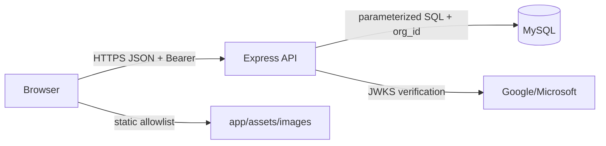

# Architecture and attack surface

| Component | Type | Stack | Entry point | Trust boundary | Sensitive data | Exposure | Tests |
| --- | --- | --- | --- | --- | --- | --- | --- |
| Browser UI | SPA-like pages | HTML/JS/Three.js | `app/*.html` | browser ↔ API | JWT, user/org data | HTTP static | jsdom/static security tests |
| API | REST | Express 4/CommonJS | `api/server.js` | public request ↔ service | credentials, sessions, inventory | `/api/*` | local ephemeral Express |
| Persistence | relational | MySQL/mysql2 | route SQL | API ↔ DB, tenant boundaries | users, orgs, stock, files | private/UNKNOWN | SQL-aware mocks; real DB unavailable |
| Identity | local + OIDC | JWT, Google/Microsoft JWKS | auth/OAuth routes | IdP ↔ API | identity assertions | outbound HTTPS | provider verifier unit path |

Assets: credentials, session tokens, tenant inventory, uploaded engineering files, roles and audit records. Principal entry points are 57 route declarations, OAuth assertions, JSON/form bodies, identifiers, local imported MapHub data and attachments. High-value sinks are SQL, authorization decisions, DOM HTML/CSS/URL contexts, filesystem/static serving and outbound JWKS HTTPS.

