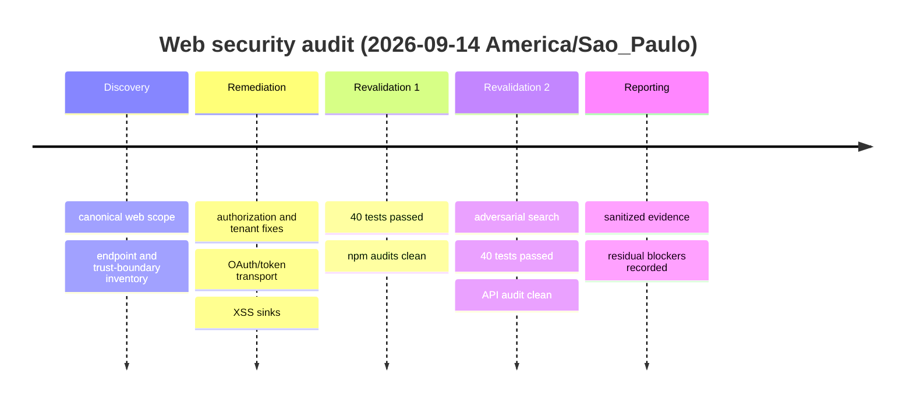

# Executive Summary

Security posture before: material authorization, session, tenant, OAuth and browser-output weaknesses were present across the web stack.
Security posture after: seven web findings from this pass were remediated and existing web controls were independently revalidated.
Confirmed findings: 7
Critical: 0
High: 1
Medium: 6
Low: 0
Fixed: 7
Remaining: 0 confirmed Critical/High in executed scope
Regression tests added: 7
Functional regression: 40/40 security/functional security tests passed in each of two final passes
Security cycles completed: 2 consecutive post-change passes
Convergence: CONVERGENCE_NOT_REACHED
Residual risk: Medium due to unavailable real-MySQL integration, external IdP and deployed-runtime validation
Primary blockers: MySQL/scanners/staging unavailable; Git executable unavailable

The web application is materially safer: privilege hierarchy, tenant references, event writes, provider authentication, file authorization transport and key XSS sinks now have server-side or contextual controls. No confirmed Critical/High remained after two consecutive passes, but full convergence cannot be claimed without a real disposable MySQL environment and deployed-runtime verification.

# Scope and Assumptions

See `scope.md`. The canonical web app is `app/` + `api/`; desktop and unreachable legacy trees are out of scope.

# Architecture and Attack Surface

See `architecture.md` and `endpoint-inventory.md`.

# Threat Model

See `threat-model.md`.

# Tools and Skills

| Technique | Tool/Skill | Version | Input | Output | Findings | Limitations | Artifact |
| --- | --- | --- | --- | --- | --- | --- | --- |
| Secure review | secure-by-default, code-review, SQL/secrets/supply-chain skills | local | web source/tests | semantic review | 7 confirmed | manual coverage | this report |
| Search/SAST heuristic | ripgrep | NOT_RECORDED | canonical source | source/sink candidates | triaged | pattern-only | command evidence |
| Tests | Node test runner | Node 24.19.0 | `tests/security` | 40 pass | regressions closed | mocked DB | test files |
| SCA | npm audit | npm 11.17.0 | lockfiles | 0 production advisories | 0 | registry snapshot | cycle evidence |
| SAST/secrets/container | Semgrep/CodeQL/Gitleaks/Trivy | NOT_AVAILABLE | N/A | N/A | NOT_RUN | tools absent | scope.md |
| DAST/IAST | N/A | NOT_AVAILABLE | N/A | N/A | NOT_RUN | no authorized runtime | scope.md |

# Methodology

Directed architecture and endpoint discovery preceded semantic source-to-sink review. Authentication, authorization, tenant predicates, SQL parameterization, uploads, DOM sinks, dependencies, static exposure and HTTP middleware were tested. Findings were reproduced through source behavior/tests, patched minimally, and retested twice with a second adversarial search perspective.

# Findings Summary

See `findings.md`.

# Detailed Findings

Evidence, root causes and acceptance status are recorded in `findings.md` and the named regression tests. All seven are FIXED within the exercised environment.

# Remediation Applied

Changed `api/middleware/auth.js`, `api/routes/organizations.js`, `app/js/auth.js`, `app/js/sistema-features.js`, `app/js/sistema-3d-viewer.js`, `app/js/sistema-builder-3d.js`, `app/onboarding.html`, `app/sistema.html` and security tests. No dependency was added and no external resource was changed. Commit: BLOCKED because Git is unavailable.

# Security Regression Tests

New coverage proves bounded superadmin changes, tenant-owned chart references, event role denial, absence of URL tokens, backend-only OAuth sessions, disabled unsupported WebAuthn, and encoding of onboarding/MapHub data.

# Functional Regression

Two final passes: 40 passed, 0 failed each. Syntax checks passed. The intentional schema-error test prints a sentinel stack to the test console; the HTTP response stays generic.

# Dependency and SBOM Analysis

API production dependency audit: 241 dependencies, 0 advisories. Root production audit: 116 production dependencies, 0 advisories. Existing SBOM artifacts from the broader audit remain in `.security-audit/sbom/`; web-specific regeneration with Trivy was NOT_AVAILABLE.

# Supply Chain Review

Lockfile-aware npm audit passed. No dependency changes occurred. CI provider files were absent in the inspected tree; immutable CI references and release provenance are NOT_APPLICABLE to repository content found, with deployment process UNKNOWN.

# CI/CD Review

No `.github` pipeline was present. Recommended gates: syntax/lint when configured, these security tests, npm audit, secret scan and SAST on PR; SBOM and container scan at release; authenticated DAST against authorized staging.

# Infrastructure / Container Review

No canonical web IaC/container deployment definition was validated. Runtime infrastructure is UNKNOWN. Docker CLI alone was insufficient for a reliable scan.

# Runtime Testing

Local ephemeral Express tests covered authentication, revoked sessions, authorization denials, tenant SQL constraints, safe downloads, CORS/static exposure and headers. Real MySQL, browser IdP flows, DAST, IAST, TLS and fuzzing were NOT_EXECUTED/NOT_AVAILABLE.

# Logs and Detection

Generic HTTP errors were validated. Centralized security-event collection, correlation and production redaction are UNKNOWN. No real secrets were written to evidence.

# Before vs After Metrics

| Technique | Before C/H/M/L | After C/H/M/L | Confirmed | False positives | New final-pass findings | Status |
| --- | --- | --- | --- | --- | --- | --- |
| Semantic web review | 0/1/6/0 | 0/0/0/0 confirmed open | 7 | 0 recorded | 0 | PASS within scope |
| npm SCA | 0/0/0/0 | 0/0/0/0 | 0 | 0 | 0 | PASS |
| Local tests | 7 causes reproducible by code/test analysis | 40/40 pass | 7 closed | N/A | 0 | PASS |

| Finding | SAST | DAST | IAST | Fuzz | Manual/data-flow | SCA | Confirmed |
| --- | --- | --- | --- | --- | --- | --- | --- |
| SEC-WEB-001..007 | heuristic/manual | NOT_RUN | NOT_RUN | NOT_RUN | YES | N/A | YES |

# Audit Cycles

| Cycle | Result | New Critical/High | Tests | SCA |
| --- | --- | --- | --- | --- |
| 1 post-change | clean | 0 | 40/40 | 0 advisories root/API |
| 2 independent | clean | 0 | 40/40 | 0 API advisories |

# Convergence

CONVERGENCE_NOT_REACHED

The two clean code/test passes satisfy the code-level criterion, but real-MySQL tenant behavior and deployed runtime/IdP controls could not be independently validated.

# Residual Risks

Database transactions/schema parity, external OAuth configuration, proxy/TLS headers, CSP compatibility and production logging remain dependent on environments not available here. Browser JWT storage in `localStorage` increases impact if another XSS is introduced; migration to server-managed HttpOnly cookies requires a coordinated CSRF/session design.

# Blockers

MYSQL_REAL_NOT_AVAILABLE; SAST/secret/container scanners NOT_AVAILABLE; DAST/IAST/staging NOT_AVAILABLE; Git metadata BLOCKED.

# Manual Actions Required

- Run the security suite against disposable MySQL with two tenants and all roles.
- Validate Google/Microsoft login end-to-end using nonproduction clients.
- Run authenticated passive/active DAST only on authorized staging.
- Verify production TLS, proxy headers, logging redaction and restrictive CSP rollout.

# Recommended CI Security Gates

Fail on a broken security regression, a real secret, or a confirmed reachable Critical/High dependency/SAST/IaC issue. Triage Medium and low-confidence results. Any exception should name a finding, owner, rationale, expiry and compensating control.

# Commit / PR Summary

Suggested title: `Security: enforce web role boundaries and trusted authentication`. Git commit/PR creation was not performed because Git is unavailable and remote operations were not authorized.

# Evidence Index

`scope.md`, `architecture.md`, `endpoint-inventory.md`, `authorization-matrix.md`, `threat-model.md`, `findings.md`, and `tests/security/*.test.js`. Evidence contains no token, cookie, private key or Authorization header value.

# Timeline

| Phase | Start | End | Duration | Status |
| --- | --- | --- | --- | --- |
| Current web pass | NOT_MEASURED | 2026-09-14T21:21:23-03:00 | NOT_MEASURED | completed with blockers |

# Final Checklist

PASS: threat model, semantic review, dependency/SCA, supply chain repository review, secrets heuristics, authn, authz, session, XSS, SQL/NoSQL/command/template injection review, path/upload controls, deserialization/SSRF/XXE/redirect review, race/crypto/timing review, CORS/headers, business logic, regression tests, two independent passes, sanitized evidence, final report.

N/A: CSRF for current Bearer-header API; canonical repository CI/IaC/container manifests not found.

NOT_AVAILABLE: SBOM regeneration tool, IAST, dedicated SAST/secret/container scanners, real MySQL.

NOT_EXECUTED: deployed CSP/TLS validation, staging DAST, protocol fuzzing, full external IdP flow.

BLOCKED: Git diff/status/commit review through Git tooling.

# Final Statement

Nenhuma vulnerabilidade confirmada de severidade Critical/High permaneceu identificada dentro do código, versões, ambiente e métodos executados após duas passagens consecutivas. A auditoria não demonstra ausência absoluta de vulnerabilidades; as limitações acima mantêm a convergência global não alcançada.
