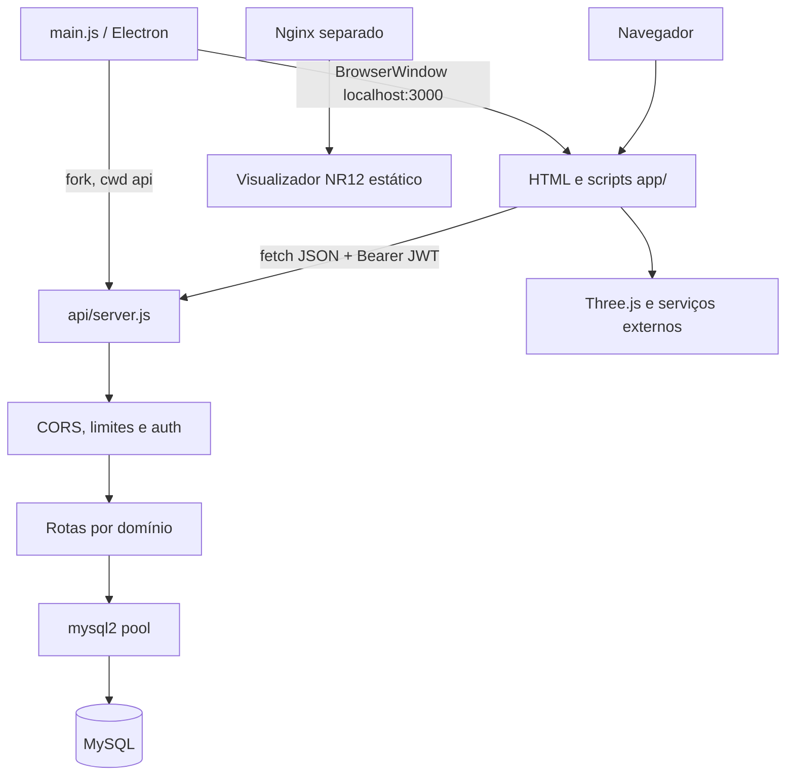
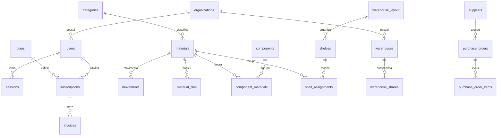

# Documentação do projeto — ASTHA RAVEN WMS

Atualização executada em 03/10/2026: [laboratório web unificado na porta 3000, dados hipotéticos, rascunhos privados, histórico paginado, backups e evidências de teste](LABORATORIO_WEB_2026_10_03.md). Esse registro é a referência atual e complementa o levantamento histórico abaixo; não equivale à homologação de produção.

Levantamento dos arquivos locais em 14/09/2026. Este documento descreve o código disponível, inclusive divergências e recursos incompletos. Não representa homologação do produto. O conteúdo de `api/.env` não foi reproduzido. Banco, serviços externos, instalador e interface não foram executados nesta análise. **⚠️ Não confirmado / assumido:** estado do ambiente implantado, dados reais, versões efetivamente instaladas e cobertura funcional.

## 1. Visão Geral do Projeto

### Propósito e público
ASTHA RAVEN é um sistema de gestão de armazém (WMS), materiais e estoque, com interface web e distribuição desktop. Atende operações de logística, manutenção e administração de organizações. A raiz também contém o antigo site EVAH OPHIM e um visualizador industrial independente para NR-12/NR-06. O manifesto raiz identifica `astha-raven` 1.0.0; o backend identifica `astah-raven-api` 2.0.0. Esses números não comprovam um estágio de produção.

### Estado e capacidades
**⚠️ Não confirmado / assumido:** classificação como aplicação em desenvolvimento/MVP, inferida das funcionalidades presentes e das lacunas abaixo; não há declaração verificável de homologação.

Implementados em código: cadastro/login local, perfis e papéis, organizações e convites, cargos e organograma, materiais com exclusão lógica, entradas e saídas transacionais, dashboard, relatórios de movimentação, armazéns, prateleiras, atribuições de localização, desenho 2D e visualização 3D, anexos em base64/URL, formulários de contato e empacotamento Windows.

Parcialmente implementados: OAuth Google/Microsoft, integração Azure, eventos de calendário e instalação reprodutível do schema completo. Planos, assinaturas, faturas, compras, notificações e WebAuthn possuem estruturas ou interfaces, mas isso não comprova um fluxo operacional completo. Não foi encontrado roadmap formal; a seção 15 apresenta sugestões, não compromissos do projeto.

Decisões relevantes: servidor Express iniciado pelo Electron como processo filho; frontend sem bundler; dados relacionais combinados com JSON/LONGTEXT para layouts e mídia; coexistência de versões do site; migrações manuais sem controle central de versão.

## 2. Stack Tecnológica

### Linguagens e execução
JavaScript no Node/Electron e navegador, HTML, CSS, SQL MySQL e Batch Windows. Não há TypeScript ou framework React/Vue nos manifestos examinados. A versão de Node não está fixada por `engines`; MySQL 8.x é citado nos comentários da conexão, mas a versão instalada não foi verificada. Os valores abaixo são os intervalos declarados nos manifestos, não versões resolvidas de instalação.

| Dependência | Versão declarada | Grupo | Manifesto |
| --- | --- | --- | --- |
| bcryptjs | ^2.4.3 | dependencies | package.json |
| mysql2 | ^3.22.3 | dependencies | package.json |
| express-rate-limit | ^7.1.5 | dependencies | package.json |
| multer | ^2.1.1 | dependencies | package.json |
| express | ^4.22.2 | dependencies | package.json |
| dotenv | ^16.6.1 | dependencies | package.json |
| cors | ^2.8.6 | dependencies | package.json |
| jsonwebtoken | ^9.0.3 | dependencies | package.json |
| helmet | ^7.2.0 | dependencies | package.json |
| electron | ^30.0.0 | devDependencies | package.json |
| electron-builder | ^24.13.3 | devDependencies | package.json |
| bcryptjs | ^2.4.3 | dependencies | api/package.json |
| cors | ^2.8.6 | dependencies | api/package.json |
| dotenv | ^16.6.1 | dependencies | api/package.json |
| express | ^4.22.2 | dependencies | api/package.json |
| express-rate-limit | ^7.1.5 | dependencies | api/package.json |
| helmet | ^7.2.0 | dependencies | api/package.json |
| jsonwebtoken | ^9.0.3 | dependencies | api/package.json |
| md-to-pdf | ^5.2.5 | dependencies | api/package.json |
| multer | ^2.1.1 | dependencies | api/package.json |
| mysql2 | ^3.22.3 | dependencies | api/package.json |
| jsdom | ^29.1.1 | dependencies | js/package.json |

Three.js é carregado por CDN em `app/sistema.html:2639`: r128/0.128.0, com OrbitControls, loaders STL/OBJ/MTL/GLTF/RGBE e exporters STL/OBJ. Banco principal: MySQL com InnoDB. Build: electron-builder/NSIS. Não há script de lint, formatter ou bundler frontend configurado. `md-to-pdf` consta no manifesto da API; a presença da dependência não comprova uso em uma rota.

## 3. Esquema Completo de Arquivos e Pastas

### Inventário de arquivos relevantes
Excluídos dependências, Git, distribuições geradas e arquivos de ambiente privados. O inventário abaixo inclui arquivos auxiliares, históricos e assets; caminhos repetidos representam cópias físicas distintas.

```text
./
├── .agents/
│   └── skills/
│       ├── code-review-lite/
│       │   └── SKILL.md
│       ├── concise-output/
│       │   └── SKILL.md
│       ├── context-hygiene/
│       │   └── SKILL.md
│       ├── surgical-code-search/
│       │   └── SKILL.md
│       └── token-budget-router/
│           └── SKILL.md
├── AGENTS.md
├── DATABASE_SETUP.txt
├── DOCUMENTACAO.md
├── PARA_ENVIAR_VPS/
│   ├── etc/
│   │   └── nginx/
│   │       └── sites-available/
│   │           └── nr12-viewer
│   └── var/
│       └── www/
│           └── nr12-viewer/
│               ├── css/
│               │   └── style.css
│               ├── index.html
│               └── js/
│                   └── main.js
├── api/
│   ├── .env.example
│   ├── database/
│   │   ├── connection.js
│   │   ├── init.js
│   │   ├── migrate_blueprint.js
│   │   ├── migrate_files.js
│   │   ├── migrate_multitenancy.js
│   │   └── migrate_orgs.js
│   ├── middleware/
│   │   ├── auth.js
│   │   ├── rateLimitByUser.js
│   │   ├── rateLimiter.js
│   │   └── validator.js
│   ├── migrate.js
│   ├── package-lock.json
│   ├── package.json
│   ├── routes/
│   │   ├── auth.js
│   │   ├── components.js
│   │   ├── contact.js
│   │   ├── material-files.js
│   │   ├── materials.js
│   │   ├── movements.js
│   │   ├── oauth.js
│   │   ├── organizations.js
│   │   └── warehouse.js
│   └── server.js
├── app/
│   ├── css/
│   │   ├── animations.css
│   │   ├── auth-redesign.css
│   │   ├── components.css
│   │   ├── fix_warehouse.sql
│   │   ├── forms.css
│   │   ├── global.css
│   │   ├── reset.css
│   │   ├── sistema.css
│   │   └── variables.css
│   ├── home.html
│   ├── images/
│   │   ├── Evhaophim1 (1).png
│   │   ├── Evhaophim1 (2).png
│   │   ├── Logotipo (Alpha).png
│   │   └── app_icon.png
│   ├── js/
│   │   ├── api.js
│   │   ├── auth.js
│   │   ├── azure.js
│   │   ├── forms.js
│   │   ├── register-wizard.js
│   │   ├── security.js
│   │   ├── sistema-3d-viewer.js
│   │   ├── sistema-builder-2d.js
│   │   ├── sistema-builder-3d.js
│   │   ├── sistema-core.js
│   │   ├── sistema-features.js
│   │   └── sistema-map.js
│   ├── login.html
│   ├── onboarding.html
│   ├── register.html
│   ├── settings.html
│   └── sistema.html
├── assets/
│   ├── astha_logo.png
│   └── images/
│       └── logo.svg
├── build_installer.bat
├── css/
│   ├── animations.css
│   ├── components.css
│   ├── forms.css
│   ├── global.css
│   ├── hero.css
│   ├── kazinho.css
│   ├── navbar.css
│   ├── reset.css
│   ├── sections.css
│   ├── sistema.css
│   └── variables.css
├── database/
│   └── schema.sql
├── desktop.ini
├── evah/
│   ├── contact.html
│   ├── eula.html
│   ├── home/
│   │   └── index.html
│   ├── index.html
│   ├── login.html
│   ├── onboarding.html
│   ├── privacidade.html
│   ├── register.html
│   ├── sistema/
│   │   └── index.html
│   ├── sobre.html
│   └── termos.html
├── fix_auth.js
├── fix_corrupt.js
├── fix_corrupt2.js
├── fix_encoding.js
├── fix_final.js
├── fix_mojibake.js
├── fix_settings.js
├── fix_settings_script.js
├── fix_ui.js
├── images/
│   ├── Evhaophim1 (1).png
│   ├── Evhaophim1 (2).png
│   └── Logotipo (Alpha).png
├── index.html
├── js/
│   ├── animations.js
│   ├── api.js
│   ├── auth.js
│   ├── azure.js
│   ├── fix_modal_structure.js
│   ├── fix_redundant_script.js
│   ├── forms.js
│   ├── main.js
│   ├── navbar.js
│   ├── package-lock.json
│   ├── package.json
│   ├── script_check_0.js
│   ├── security.js
│   ├── sistema-3d-viewer.js
│   ├── sistema-builder-2d.js
│   ├── sistema-builder-3d.js
│   ├── sistema-core.js
│   ├── sistema-features.js
│   ├── sistema-map.js
│   ├── test_dom.js
│   ├── update_admin_orgs.js
│   ├── update_admin_users.js
│   ├── update_colors.js
│   ├── update_home.js
│   ├── update_home2.js
│   └── update_sistema.js
├── main.js
├── nr12-visualizador-deploy.zip
├── old/
│   ├── css/
│   │   ├── animations.css
│   │   ├── components.css
│   │   ├── forms.css
│   │   ├── global.css
│   │   ├── hero.css
│   │   ├── kazinho.css
│   │   ├── navbar.css
│   │   ├── reset.css
│   │   ├── sections.css
│   │   ├── sistema.css
│   │   └── variables.css
│   ├── evah/
│   │   ├── contact.html
│   │   ├── eula.html
│   │   ├── home/
│   │   │   └── index.html
│   │   ├── index.html
│   │   ├── login.html
│   │   ├── onboarding.html
│   │   ├── privacidade.html
│   │   ├── register.html
│   │   ├── sistema/
│   │   │   └── index.html
│   │   ├── sobre.html
│   │   └── termos.html
│   ├── images/
│   │   ├── Evhaophim1 (1).png
│   │   ├── Evhaophim1 (2).png
│   │   └── Logotipo (Alpha).png
│   ├── index.html
│   └── js/
│       ├── animations.js
│       ├── api.js
│       ├── auth.js
│       ├── azure.js
│       ├── forms.js
│       ├── main.js
│       ├── navbar.js
│       ├── script_check_0.js
│       ├── security.js
│       ├── sistema-3d-viewer.js
│       ├── sistema-builder-2d.js
│       ├── sistema-builder-3d.js
│       ├── sistema-core.js
│       ├── sistema-features.js
│       └── sistema-map.js
├── package-lock.json
├── package.json
├── query
├── remove_emojis.js
├── remove_emojis_js.js
├── script_dump.txt
├── temp_ribbon.txt
├── temp_tabs.txt
├── test-login.js
└── test-static.js
```

| Pasta | Responsabilidade |
| --- | --- |
| app/ | Interface atual, páginas, scripts, CSS e imagens do WMS. |
| api/ | Servidor Express, autenticação, consultas SQL e migrações. |
| database/ | Schema SQL, views, trigger e seeds. |
| evah/ | Páginas da identidade antiga, incluindo home e sistema. |
| js/ e css/ | Scripts/estilos paralelos da raiz e ferramentas de correção; verificar referências antes de editar. |
| old/ | Cópia arquivada do site, também servida pelo backend. |
| assets/ e images/ | Logotipos e imagens. |
| PARA_ENVIAR_VPS/ | Pacote separado de site estático e configuração Nginx para visualizador industrial. |
| .agents/skills/ | Instruções locais de busca, revisão e comunicação. |

| Arquivo | Responsabilidade | Exports/funções | Dependências internas |
| --- | --- | --- | --- |
| main.js | Ciclo desktop e API filha | createWindow | api/server.js |
| api/server.js | Middlewares, rotas, estáticos e startup | startServer | routes/*, database/connection |
| api/database/connection.js | Pool MySQL e verificação | pool, testConnection | dotenv |
| api/middleware/auth.js | Validação JWT | authMiddleware | nenhuma |
| app/js/api.js | Wrapper fetch e envelope de resposta | API.request/get/post/put/delete | astha_token no localStorage |
| app/js/auth.js | Sessão, guardas e permissões de interface | Auth | API HTTP |
| app/js/sistema-core.js | Carga inicial, adaptação de dados e renderização | initAppData, mapMaterialToFrontend, renderStock | API, Auth |
| app/js/sistema-features.js | Materiais, anexos, movimentos, componentes, usuários | handleMaterialSubmit, handleEntry, handleExit | API e estado global |
| app/js/sistema-builder-2d.js | Editor canvas de plantas | renderCad, setupCadEvents | blueprint e DOM |
| app/js/sistema-builder-3d.js | Cena tridimensional do armazém | parseLocation, loadProduct3D | Three.js, blueprint |
| app/js/sistema-3d-viewer.js | Visualização de arquivos de materiais | open3DViewer, close3DViewer | Three.js, API de anexos |
| database/schema.sql | Modelo base e exemplos | DDL, views, trigger | MySQL |
| build_installer.bat | Instalação e build manual | npm install, npm run build | package.json |

Arquivos `fix_*.js`, `remove_emojis*.js`, `js/update_*.js` e arquivos `temp_*`/`script_dump.txt` são ferramentas/resíduos de edição. Não são entrypoints do produto. A execução indiscriminada pode modificar fontes. `nr12-visualizador-deploy.zip` é um artefato; seu conteúdo não foi usado como fonte do sistema atual.

## 4. Arquitetura do Sistema

### Organização e fluxo
Monólito Express com roteadores por domínio, middleware transversal e consultas SQL diretamente nos handlers. Não há camada repository/service separada. CommonJS organiza o backend; objetos globais, funções e eventos DOM organizam o frontend. O pool de conexão compartilhado é reutilizado pelos módulos.



Em `main.js`, a API é iniciada na pasta `api/`, com porta 3000; a janela abre após dois segundos, sem aguardar readiness. A janela usa `nodeIntegration: false` e `contextIsolation: true`. O processo filho é encerrado no fechamento da aplicação.

Login envia email/senha, consulta usuário, verifica bcrypt e devolve JWT. O cliente guarda token/usuário em localStorage. O middleware valida assinatura e expiração e preenche `req.user`. `initAppData` carrega abas, materiais, movimentos, componentes e usuários, adapta os dados e atualiza DOM. Falhas individuais podem produzir dados parciais; mensagem de bootstrap não prova que todas as requisições deram certo.

Entradas/saídas abrem transação, consultam saldo, atualizam quantidade e inserem movimentação. O trigger SQL pode gerar alerta. A presença de transação não resolve sozinha concorrência no cálculo de saída: revisar bloqueio de linha/UPDATE condicional. Anexos são armazenados como texto base64 ou URL; download decodifica o conteúdo ou redireciona.

## 5. Banco de Dados e Modelos de Dados

### Escopo e estado
O schema base está em `database/schema.sql`; as definições abaixo são extraídas do DDL disponível, com tipos, defaults, índices e chaves preservados. Colunas de migrações devem ser somadas ao modelo base; não são prova de aplicação no banco. **⚠️ Não confirmado / assumido:** estado efetivo do schema implantado.

### Entidade `organizations`

Fonte: `database/schema.sql:17`.

| Campo | Tipo e definição SQL |
| --- | --- |
| id | VARCHAR(50) PRIMARY KEY |
| name | VARCHAR(200) NOT NULL |
| plan | VARCHAR(50) DEFAULT 'Enterprise' |
| logo | LONGTEXT |
| policies | JSON |
| created_at | TIMESTAMP DEFAULT CURRENT_TIMESTAMP |
| updated_at | TIMESTAMP DEFAULT CURRENT_TIMESTAMP ON UPDATE CURRENT_TIMESTAMP |

### Entidade `users`

Fonte: `database/schema.sql:27`.

| Campo | Tipo e definição SQL |
| --- | --- |
| id | INT AUTO_INCREMENT PRIMARY KEY |
| name | VARCHAR(100) NOT NULL |
| surname | VARCHAR(100) |
| email | VARCHAR(255) NOT NULL UNIQUE |
| password_hash | VARCHAR(255) |
| company | VARCHAR(200) |
| phone | VARCHAR(30) |
| role | ENUM('superadmin','admin','manager','operator','viewer') NOT NULL DEFAULT 'viewer' |
| avatar_url | LONGTEXT |
| org_id | VARCHAR(50) DEFAULT 'org_1' |
| sector | VARCHAR(100) DEFAULT 'Logística' |
| provider | ENUM('local','google','microsoft','webauthn') DEFAULT 'local' |
| provider_id | VARCHAR(255) |
| is_active | TINYINT(1) NOT NULL DEFAULT 1 |
| email_verified | TINYINT(1) NOT NULL DEFAULT 0 |
| last_login_at | TIMESTAMP NULL |
| failed_logins | INT NOT NULL DEFAULT 0 |
| locked_until | TIMESTAMP NULL |
| created_at | TIMESTAMP DEFAULT CURRENT_TIMESTAMP |
| updated_at | TIMESTAMP DEFAULT CURRENT_TIMESTAMP ON UPDATE CURRENT_TIMESTAMP |

Índices/relacionamentos declarados:

```sql
INDEX idx_email (email)
INDEX idx_role (role)
INDEX idx_provider (provider)
FOREIGN KEY (org_id) REFERENCES organizations(id) ON DELETE SET NULL
```

### Entidade `sessions`

Fonte: `database/schema.sql:54`.

| Campo | Tipo e definição SQL |
| --- | --- |
| id | INT AUTO_INCREMENT PRIMARY KEY |
| user_id | INT NOT NULL |
| token | VARCHAR(500) NOT NULL |
| provider | VARCHAR(20) DEFAULT 'local' |
| ip_address | VARCHAR(45) |
| user_agent | TEXT |
| expires_at | TIMESTAMP NOT NULL |
| created_at | TIMESTAMP DEFAULT CURRENT_TIMESTAMP |

Índices/relacionamentos declarados:

```sql
INDEX idx_token (token(255))
INDEX idx_user (user_id)
INDEX idx_expires (expires_at)
FOREIGN KEY (user_id) REFERENCES users(id) ON DELETE CASCADE
```

### Entidade `webauthn_credentials`

Fonte: `database/schema.sql:69`.

| Campo | Tipo e definição SQL |
| --- | --- |
| id | INT AUTO_INCREMENT PRIMARY KEY |
| user_id | INT NOT NULL |
| credential_id | TEXT NOT NULL |
| public_key | TEXT NOT NULL |
| sign_count | INT DEFAULT 0 |
| device_name | VARCHAR(100) |
| created_at | TIMESTAMP DEFAULT CURRENT_TIMESTAMP |

Índices/relacionamentos declarados:

```sql
FOREIGN KEY (user_id) REFERENCES users(id) ON DELETE CASCADE
```

### Entidade `password_resets`

Fonte: `database/schema.sql:80`.

| Campo | Tipo e definição SQL |
| --- | --- |
| id | INT AUTO_INCREMENT PRIMARY KEY |
| user_id | INT NOT NULL |
| token | VARCHAR(255) NOT NULL UNIQUE |
| used | TINYINT(1) NOT NULL DEFAULT 0 |
| expires_at | TIMESTAMP NOT NULL |
| created_at | TIMESTAMP DEFAULT CURRENT_TIMESTAMP |

Índices/relacionamentos declarados:

```sql
FOREIGN KEY (user_id) REFERENCES users(id) ON DELETE CASCADE
```

### Entidade `plans`

Fonte: `database/schema.sql:94`.

| Campo | Tipo e definição SQL |
| --- | --- |
| id | INT AUTO_INCREMENT PRIMARY KEY |
| slug | VARCHAR(30) NOT NULL UNIQUE |
| name | VARCHAR(100) NOT NULL |
| price_monthly | DECIMAL(10,2) DEFAULT 0.00 |
| price_annual | DECIMAL(10,2) DEFAULT 0.00 |
| max_users | INT DEFAULT 1 |
| max_materials | INT DEFAULT 100 |
| features | JSON COMMENT '["dashboard","mapa_2d","api"]' |
| sla_uptime | DECIMAL(4,2) DEFAULT 0.00 |
| is_active | TINYINT(1) NOT NULL DEFAULT 1 |
| created_at | TIMESTAMP DEFAULT CURRENT_TIMESTAMP |

### Entidade `subscriptions`

Fonte: `database/schema.sql:108`.

| Campo | Tipo e definição SQL |
| --- | --- |
| id | INT AUTO_INCREMENT PRIMARY KEY |
| user_id | INT NOT NULL |
| plan_id | INT NOT NULL |
| billing_cycle | ENUM('monthly','annual') DEFAULT 'monthly' |
| status | ENUM('active','past_due','cancelled','trial','expired') DEFAULT 'trial' |
| trial_ends_at | TIMESTAMP NULL |
| current_period_start | TIMESTAMP NULL |
| current_period_end | TIMESTAMP NULL |
| cancelled_at | TIMESTAMP NULL |
| created_at | TIMESTAMP DEFAULT CURRENT_TIMESTAMP |
| updated_at | TIMESTAMP DEFAULT CURRENT_TIMESTAMP ON UPDATE CURRENT_TIMESTAMP |

Índices/relacionamentos declarados:

```sql
INDEX idx_user (user_id)
INDEX idx_status (status)
FOREIGN KEY (user_id) REFERENCES users(id) ON DELETE CASCADE
FOREIGN KEY (plan_id) REFERENCES plans(id)
```

### Entidade `invoices`

Fonte: `database/schema.sql:126`.

| Campo | Tipo e definição SQL |
| --- | --- |
| id | INT AUTO_INCREMENT PRIMARY KEY |
| subscription_id | INT NOT NULL |
| amount | DECIMAL(10,2) NOT NULL |
| currency | VARCHAR(5) DEFAULT 'BRL' |
| status | ENUM('pending','paid','failed','refunded') DEFAULT 'pending' |
| paid_at | TIMESTAMP NULL |
| due_date | DATE NOT NULL |
| created_at | TIMESTAMP DEFAULT CURRENT_TIMESTAMP |

Índices/relacionamentos declarados:

```sql
FOREIGN KEY (subscription_id) REFERENCES subscriptions(id) ON DELETE CASCADE
```

### Entidade `categories`

Fonte: `database/schema.sql:142`.

| Campo | Tipo e definição SQL |
| --- | --- |
| id | INT AUTO_INCREMENT PRIMARY KEY |
| name | VARCHAR(100) NOT NULL |
| slug | VARCHAR(100) NOT NULL UNIQUE |
| description | TEXT |
| color | VARCHAR(7) DEFAULT '#6C63FF' |
| parent_id | INT NULL |
| created_at | TIMESTAMP DEFAULT CURRENT_TIMESTAMP |

Índices/relacionamentos declarados:

```sql
FOREIGN KEY (parent_id) REFERENCES categories(id) ON DELETE SET NULL
```

### Entidade `materials`

Fonte: `database/schema.sql:153`.

| Campo | Tipo e definição SQL |
| --- | --- |
| id | INT AUTO_INCREMENT PRIMARY KEY |
| code | VARCHAR(20) NOT NULL UNIQUE COMMENT 'Ex: MERB-00000001' |
| description | VARCHAR(300) NOT NULL |
| brand | VARCHAR(100) |
| model | VARCHAR(100) |
| category_id | INT NULL |
| sector | VARCHAR(100) COMMENT 'Ex: Assembly, Paint, Body' |
| location | VARCHAR(50) COMMENT 'Ex: A1-N2-P3' |
| quantity | INT NOT NULL DEFAULT 0 |
| min_qty | INT NOT NULL DEFAULT 0 |
| max_qty | INT NOT NULL DEFAULT 0 |
| unit_price | DECIMAL(12,2) DEFAULT 0.00 |
| currency | VARCHAR(5) DEFAULT 'BRL' |
| unit | VARCHAR(20) DEFAULT 'UN' COMMENT 'UN, KG, L, M, CX' |
| barcode | VARCHAR(50) |
| image_url | VARCHAR(500) |
| image_data | LONGTEXT COMMENT 'Base64 para uso offline' |
| manual_url | VARCHAR(500) |
| manual_data | LONGTEXT COMMENT 'PDF em Base64' |
| manual_filename | VARCHAR(200) |
| interchangeable | TINYINT(1) NOT NULL DEFAULT 0 |
| interchange_with | TEXT COMMENT 'Códigos substitutos separados por vírgula' |
| notes | TEXT |
| machinery | VARCHAR(200) |
| is_active | TINYINT(1) NOT NULL DEFAULT 1 |
| created_by | INT |
| created_at | TIMESTAMP DEFAULT CURRENT_TIMESTAMP |
| updated_at | TIMESTAMP DEFAULT CURRENT_TIMESTAMP ON UPDATE CURRENT_TIMESTAMP |

Índices/relacionamentos declarados:

```sql
INDEX idx_code (code)
INDEX idx_sector (sector)
INDEX idx_brand (brand)
INDEX idx_barcode (barcode)
INDEX idx_category (category_id)
FOREIGN KEY (category_id) REFERENCES categories(id) ON DELETE SET NULL
FOREIGN KEY (created_by) REFERENCES users(id) ON DELETE SET NULL
```

### Entidade `movements`

Fonte: `database/schema.sql:191`.

| Campo | Tipo e definição SQL |
| --- | --- |
| id | INT AUTO_INCREMENT PRIMARY KEY |
| material_id | INT NOT NULL |
| type | ENUM('entrada','saida') NOT NULL |
| quantity | INT NOT NULL |
| nf_number | VARCHAR(50) |
| responsible | VARCHAR(100) |
| reason | VARCHAR(300) |
| notes | TEXT |
| created_by | INT |
| created_at | TIMESTAMP DEFAULT CURRENT_TIMESTAMP |

Índices/relacionamentos declarados:

```sql
INDEX idx_material (material_id)
INDEX idx_type (type)
INDEX idx_date (created_at)
FOREIGN KEY (material_id) REFERENCES materials(id) ON DELETE CASCADE
FOREIGN KEY (created_by) REFERENCES users(id) ON DELETE SET NULL
```

### Entidade `components`

Fonte: `database/schema.sql:213`.

| Campo | Tipo e definição SQL |
| --- | --- |
| id | INT AUTO_INCREMENT PRIMARY KEY |
| name | VARCHAR(200) NOT NULL |
| description | TEXT |
| created_by | INT |
| created_at | TIMESTAMP DEFAULT CURRENT_TIMESTAMP |
| updated_at | TIMESTAMP DEFAULT CURRENT_TIMESTAMP ON UPDATE CURRENT_TIMESTAMP |

Índices/relacionamentos declarados:

```sql
FOREIGN KEY (created_by) REFERENCES users(id) ON DELETE SET NULL
```

### Entidade `component_materials`

Fonte: `database/schema.sql:223`.

| Campo | Tipo e definição SQL |
| --- | --- |
| id | INT AUTO_INCREMENT PRIMARY KEY |
| component_id | INT NOT NULL |
| material_id | INT NOT NULL |
| quantity | INT NOT NULL DEFAULT 1 |

Índices/relacionamentos declarados:

```sql
FOREIGN KEY (component_id) REFERENCES components(id) ON DELETE CASCADE
FOREIGN KEY (material_id) REFERENCES materials(id) ON DELETE CASCADE
UNIQUE KEY uk_comp_mat (component_id, material_id)
```

### Entidade `warehouse_layout`

Fonte: `database/schema.sql:237`.

| Campo | Tipo e definição SQL |
| --- | --- |
| id | INT AUTO_INCREMENT PRIMARY KEY |
| name | VARCHAR(100) DEFAULT 'Armazém Principal' |
| room_w | INT NOT NULL DEFAULT 720 |
| room_h | INT NOT NULL DEFAULT 480 |
| door_x | INT DEFAULT 620 |
| door_y | INT DEFAULT 480 |
| door_w | INT DEFAULT 100 |
| aisles | JSON |
| is_active | TINYINT(1) NOT NULL DEFAULT 1 |
| created_at | TIMESTAMP DEFAULT CURRENT_TIMESTAMP |
| updated_at | TIMESTAMP DEFAULT CURRENT_TIMESTAMP ON UPDATE CURRENT_TIMESTAMP |

### Entidade `shelves`

Fonte: `database/schema.sql:251`.

| Campo | Tipo e definição SQL |
| --- | --- |
| id | INT AUTO_INCREMENT PRIMARY KEY |
| layout_id | INT NOT NULL |
| shelf_code | VARCHAR(5) NOT NULL |
| pos_x | INT NOT NULL DEFAULT 0 |
| pos_y | INT NOT NULL DEFAULT 0 |
| width | INT NOT NULL DEFAULT 120 |
| height | INT NOT NULL DEFAULT 80 |
| levels | INT NOT NULL DEFAULT 4 |
| positions | INT NOT NULL DEFAULT 5 |
| created_at | TIMESTAMP DEFAULT CURRENT_TIMESTAMP |

Índices/relacionamentos declarados:

```sql
FOREIGN KEY (layout_id) REFERENCES warehouse_layout(id) ON DELETE CASCADE
UNIQUE KEY uk_layout_shelf (layout_id, shelf_code)
```

### Entidade `shelf_assignments`

Fonte: `database/schema.sql:266`.

| Campo | Tipo e definição SQL |
| --- | --- |
| id | INT AUTO_INCREMENT PRIMARY KEY |
| shelf_id | INT NOT NULL |
| level | INT NOT NULL |
| position | INT NOT NULL |
| material_id | INT NOT NULL |
| assigned_at | TIMESTAMP DEFAULT CURRENT_TIMESTAMP |

Índices/relacionamentos declarados:

```sql
FOREIGN KEY (shelf_id) REFERENCES shelves(id) ON DELETE CASCADE
FOREIGN KEY (material_id) REFERENCES materials(id) ON DELETE CASCADE
UNIQUE KEY uk_shelf_slot (shelf_id, level, position)
```

### Entidade `suppliers`

Fonte: `database/schema.sql:282`.

| Campo | Tipo e definição SQL |
| --- | --- |
| id | INT AUTO_INCREMENT PRIMARY KEY |
| name | VARCHAR(200) NOT NULL |
| cnpj | VARCHAR(18) UNIQUE |
| contact_name | VARCHAR(100) |
| contact_email | VARCHAR(255) |
| contact_phone | VARCHAR(30) |
| address | TEXT |
| notes | TEXT |
| is_active | TINYINT(1) NOT NULL DEFAULT 1 |
| created_at | TIMESTAMP DEFAULT CURRENT_TIMESTAMP |
| updated_at | TIMESTAMP DEFAULT CURRENT_TIMESTAMP ON UPDATE CURRENT_TIMESTAMP |

Índices/relacionamentos declarados:

```sql
INDEX idx_cnpj (cnpj)
```

### Entidade `purchase_orders`

Fonte: `database/schema.sql:297`.

| Campo | Tipo e definição SQL |
| --- | --- |
| id | INT AUTO_INCREMENT PRIMARY KEY |
| po_number | VARCHAR(30) NOT NULL UNIQUE |
| supplier_id | INT NOT NULL |
| status | ENUM('draft','sent','confirmed','partial','received','cancelled') DEFAULT 'draft' |
| total_amount | DECIMAL(12,2) DEFAULT 0.00 |
| currency | VARCHAR(5) DEFAULT 'BRL' |
| expected_at | DATE |
| received_at | TIMESTAMP NULL |
| notes | TEXT |
| created_by | INT |
| created_at | TIMESTAMP DEFAULT CURRENT_TIMESTAMP |
| updated_at | TIMESTAMP DEFAULT CURRENT_TIMESTAMP ON UPDATE CURRENT_TIMESTAMP |

Índices/relacionamentos declarados:

```sql
FOREIGN KEY (supplier_id) REFERENCES suppliers(id)
FOREIGN KEY (created_by) REFERENCES users(id) ON DELETE SET NULL
```

### Entidade `purchase_order_items`

Fonte: `database/schema.sql:314`.

| Campo | Tipo e definição SQL |
| --- | --- |
| id | INT AUTO_INCREMENT PRIMARY KEY |
| po_id | INT NOT NULL |
| material_id | INT NOT NULL |
| quantity | INT NOT NULL |
| unit_price | DECIMAL(12,2) NOT NULL |
| received_qty | INT DEFAULT 0 |

Índices/relacionamentos declarados:

```sql
FOREIGN KEY (po_id) REFERENCES purchase_orders(id) ON DELETE CASCADE
FOREIGN KEY (material_id) REFERENCES materials(id)
```

### Entidade `notifications`

Fonte: `database/schema.sql:329`.

| Campo | Tipo e definição SQL |
| --- | --- |
| id | INT AUTO_INCREMENT PRIMARY KEY |
| user_id | INT NOT NULL |
| type | ENUM('info','warning','error','success') DEFAULT 'info' |
| title | VARCHAR(200) NOT NULL |
| message | TEXT |
| link | VARCHAR(500) |
| is_read | TINYINT(1) NOT NULL DEFAULT 0 |
| created_at | TIMESTAMP DEFAULT CURRENT_TIMESTAMP |

Índices/relacionamentos declarados:

```sql
INDEX idx_user_read (user_id, is_read)
FOREIGN KEY (user_id) REFERENCES users(id) ON DELETE CASCADE
```

### Entidade `stock_alerts`

Fonte: `database/schema.sql:342`.

| Campo | Tipo e definição SQL |
| --- | --- |
| id | INT AUTO_INCREMENT PRIMARY KEY |
| material_id | INT NOT NULL |
| alert_type | ENUM('below_min','above_max','zero_stock','expiring') NOT NULL |
| status | ENUM('active','acknowledged','resolved') DEFAULT 'active' |
| resolved_at | TIMESTAMP NULL |
| resolved_by | INT NULL |
| created_at | TIMESTAMP DEFAULT CURRENT_TIMESTAMP |

Índices/relacionamentos declarados:

```sql
INDEX idx_status (status)
FOREIGN KEY (material_id) REFERENCES materials(id) ON DELETE CASCADE
FOREIGN KEY (resolved_by) REFERENCES users(id) ON DELETE SET NULL
```

### Entidade `contact_messages`

Fonte: `database/schema.sql:359`.

| Campo | Tipo e definição SQL |
| --- | --- |
| id | INT AUTO_INCREMENT PRIMARY KEY |
| name | VARCHAR(100) NOT NULL |
| email | VARCHAR(255) NOT NULL |
| subject | VARCHAR(200) DEFAULT 'Geral' |
| message | TEXT NOT NULL |
| is_read | TINYINT(1) NOT NULL DEFAULT 0 |
| replied_at | TIMESTAMP NULL |
| created_at | TIMESTAMP DEFAULT CURRENT_TIMESTAMP |

Índices/relacionamentos declarados:

```sql
INDEX idx_email (email)
INDEX idx_date (created_at)
```

### Entidade `audit_log`

Fonte: `database/schema.sql:376`.

| Campo | Tipo e definição SQL |
| --- | --- |
| id | BIGINT AUTO_INCREMENT PRIMARY KEY |
| user_id | INT |
| action | VARCHAR(50) NOT NULL COMMENT 'CREATE, UPDATE, DELETE, LOGIN, LOGOUT, EXPORT' |
| entity_type | VARCHAR(50) |
| entity_id | INT |
| old_values | JSON |
| new_values | JSON |
| ip_address | VARCHAR(45) |
| user_agent | VARCHAR(500) |
| created_at | TIMESTAMP DEFAULT CURRENT_TIMESTAMP |

Índices/relacionamentos declarados:

```sql
INDEX idx_user_action (user_id, action)
INDEX idx_entity (entity_type, entity_id)
INDEX idx_date (created_at)
FOREIGN KEY (user_id) REFERENCES users(id) ON DELETE SET NULL
```

### Entidade `system_settings`

Fonte: `database/schema.sql:397`.

| Campo | Tipo e definição SQL |
| --- | --- |
| id | INT AUTO_INCREMENT PRIMARY KEY |
| setting_key | VARCHAR(100) NOT NULL UNIQUE |
| setting_val | TEXT |
| description | VARCHAR(300) |
| updated_at | TIMESTAMP DEFAULT CURRENT_TIMESTAMP ON UPDATE CURRENT_TIMESTAMP |

### Entidade `material_files`

Fonte: `api/database/migrate_files.js:6`.

| Campo | Tipo e definição SQL |
| --- | --- |
| id | INT AUTO_INCREMENT PRIMARY KEY |
| material_id | INT NOT NULL |
| category | ENUM('product_3d','machinery_3d','manual','electrical','mechanical','other') NOT NULL DEFAULT 'other' |
| filename | VARCHAR(500) NOT NULL |
| mime_type | VARCHAR(100) DEFAULT NULL |
| file_data | LONGTEXT DEFAULT NULL |
| file_url | VARCHAR(1000) DEFAULT NULL |
| description | VARCHAR(500) DEFAULT NULL |
| file_size_kb | INT DEFAULT NULL |
| created_at | TIMESTAMP DEFAULT CURRENT_TIMESTAMP |

Índices/relacionamentos declarados:

```sql
FOREIGN KEY (material_id) REFERENCES materials(id) ON DELETE CASCADE
```

### Entidade `warehouses`

Fonte: `api/database/migrate_multitenancy.js:12`.

| Campo | Tipo e definição SQL |
| --- | --- |
| id | INT AUTO_INCREMENT PRIMARY KEY |
| org_id | VARCHAR(50) NOT NULL |
| name | VARCHAR(100) NOT NULL |
| tab_number | INT DEFAULT 1 |
| is_shared | TINYINT(1) DEFAULT 0 |
| created_at | TIMESTAMP DEFAULT CURRENT_TIMESTAMP |

Índices/relacionamentos declarados:

```sql
FOREIGN KEY (org_id) REFERENCES organizations(id) ON DELETE CASCADE
```

### Entidade `warehouse_shares`

Fonte: `api/database/migrate_multitenancy.js:66`.

| Campo | Tipo e definição SQL |
| --- | --- |
| warehouse_id | INT NOT NULL |
| shared_with_org_id | VARCHAR(50) NOT NULL |

Índices/relacionamentos declarados:

```sql
PRIMARY KEY (warehouse_id, shared_with_org_id)
FOREIGN KEY (warehouse_id) REFERENCES warehouses(id) ON DELETE CASCADE
FOREIGN KEY (shared_with_org_id) REFERENCES organizations(id) ON DELETE CASCADE
```

### Entidade `org_positions`

Fonte: `api/database/migrate_orgs.js:36`.

| Campo | Tipo e definição SQL |
| --- | --- |
| id | INT AUTO_INCREMENT PRIMARY KEY |
| org_id | VARCHAR(50) NOT NULL |
| name | VARCHAR(100) NOT NULL |
| department | VARCHAR(100) DEFAULT NULL |
| level | INT DEFAULT 3 COMMENT '1=Diretoria, 2=Gerência, 3=Operacional' |
| color | VARCHAR(20) DEFAULT '#4A6CF7' |
| permissions | JSON DEFAULT NULL |
| created_at | TIMESTAMP DEFAULT CURRENT_TIMESTAMP |

Índices/relacionamentos declarados:

```sql
INDEX idx_org_positions_org (org_id)
```

### Entidade `org_chart`

Fonte: `api/database/migrate_orgs.js:52`.

| Campo | Tipo e definição SQL |
| --- | --- |
| id | INT AUTO_INCREMENT PRIMARY KEY |
| org_id | VARCHAR(50) NOT NULL |
| user_id | INT DEFAULT NULL |
| position_id | INT DEFAULT NULL |
| reports_to | INT DEFAULT NULL COMMENT 'FK para org_chart.id (nó pai)' |
| node_label | VARCHAR(200) DEFAULT NULL COMMENT 'Nome quando não há user vinculado' |
| created_at | TIMESTAMP DEFAULT CURRENT_TIMESTAMP |

Índices/relacionamentos declarados:

```sql
INDEX idx_org_chart_org (org_id)
INDEX idx_org_chart_reports (reports_to)
```

### Entidade `org_invites`

Fonte: `api/database/migrate_orgs.js:68`.

| Campo | Tipo e definição SQL |
| --- | --- |
| id | INT AUTO_INCREMENT PRIMARY KEY |
| org_id | VARCHAR(50) NOT NULL |
| code | VARCHAR(20) NOT NULL UNIQUE |
| email | VARCHAR(200) DEFAULT NULL COMMENT 'Se null, qualquer um com o código pode entrar' |
| role | VARCHAR(50) DEFAULT 'viewer' |
| position_id | INT DEFAULT NULL |
| used_by | INT DEFAULT NULL |
| used_at | TIMESTAMP NULL DEFAULT NULL |
| expires_at | TIMESTAMP NOT NULL |
| created_by | INT NOT NULL |
| created_at | TIMESTAMP DEFAULT CURRENT_TIMESTAMP |

Índices/relacionamentos declarados:

```sql
INDEX idx_org_invites_code (code)
INDEX idx_org_invites_org (org_id)
```

### Relações principais



O diagrama seleciona relações centrais; o DDL acima é a referência para ações ON DELETE e constraints. `org_chart.reports_to` é descrito como relação ao próprio nó, porém a migração não declara FOREIGN KEY. Campos `org_id` adicionados por ALTER nem sempre têm FK.

### Migrações, views e seeds

| Arquivo | Efeito e limitações |
| --- | --- |
| api/migrate.js | Apaga tabelas e recria base; altera materials.notes para LONGTEXT, description para TEXT e interchange_with para MEDIUMTEXT; adiciona machinery_image MEDIUMTEXT, machinery_desc TEXT, usage_desc TEXT e manufacturer_url VARCHAR(500). Não é uma atualização incremental segura. |
| api/database/init.js | Apaga tabelas antes de importar schema; substitui hash placeholder; continua após diversos erros SQL e pode imprimir sucesso apesar de falhas. |
| api/database/migrate_multitenancy.js | Cria warehouses/warehouse_shares, adiciona org_id em materials/movements/categories/components/warehouse_layout e warehouse_id em materials; preenche legado com org_1. |
| api/database/migrate_blueprint.js | Adiciona warehouse_layout.blueprint_data LONGTEXT. |
| api/database/migrate_files.js | Cria material_files para anexos. |
| api/database/migrate_orgs.js | Expande organizations com slug, cnpj, email, phone, address, city, state, logo_url, setup_done, owner_id; cria posições, organograma e convites; users recebe setup_done, position_id, position_label. Também altera um usuário de teste por ID. |
| app/css/fix_warehouse.sql | SQL de correção de armazém em pasta de estilos; revisar separadamente, não assumir execução automática. |

`vw_low_stock` seleciona materiais ativos abaixo do mínimo; `vw_stock_value` agrega quantidade e valor por setor; `vw_recent_movements` retorna até 100 movimentos recentes com material/usuário. `trg_stock_alert_after_movement` reage à inserção de movimento para produzir alerta de estoque.

Seeds incluem planos, organização `org_1`, usuário administrador com hash placeholder, assinatura, categorias, layout, prateleiras, fornecedores, materiais, configurações e notificações. São dados de exemplo; não são uma base de produção nem credenciais de login homologadas.

Há divergência de schema: `auth.js` usa `users.dob`, `gender` e `country`; o schema e as migrações examinadas não os definem. `organizations.js` usa tabela `events` com `id`, `org_id`, `title`, `event_date`, `sector`, `color`; DDL/tipos dessa tabela não foram encontrados nas fontes de schema examinadas. Não inferir tipos ou criar schema automaticamente a partir desses usos.

## 6. APIs e Endpoints (se aplicável)

### Convenções
Prefixo `/api`; conteúdo JSON, exceto download/redirect de arquivos. JWT via `Authorization: Bearer <token>`; o middleware também aceita `?token=`, usado pelo visualizador. Erros normalmente usam `{ "error": "mensagem" }`; expiração acrescenta `expired: true`. Não há envelope único de sucesso: listas, objetos, mensagens e `{success:true}` coexistem. Status comuns: 400, 401, 403, 404, 409, 429 e 500.

A tabela inventaria todas as declarações dos roteadores. Parâmetros mostram nomes extraídos do corpo/query e identificadores do caminho; validação obrigatória deve seguir o handler, pois nem todo campo é obrigatório. A coluna resposta transcreve expressões de `res.json` quando legíveis; nomes como `rows` indicam resultado SQL. Papéis adicionais são aplicados por determinados handlers administrativos.

| Método | Rota | Módulo / fonte | Parâmetros | Resposta de sucesso no código | Autenticação |
| --- | --- | --- | --- | --- | --- |
| POST | /api/auth/register | auth; api/routes/auth.js:54 | body: name, surname, email, password, invite_code, dob, gender, country, phone | { token, user: { id: userId, name, email: email.toLowerCase().trim(), role: userRole, org_id: orgId }, setup_done: true, message: 'Conta criada e vinculada à organização com sucesso!' } / { token, user: { id: userId, name, email: email.toLowerCase().trim(), role: 'superadmin', org_id: orgId }, setup_done: false, // triggers onboarding redirect: '/app/onboarding.html' } | Sem middleware JWT |
| POST | /api/auth/login | auth; api/routes/auth.js:159 | body: email, password | { token, setup_done: setupDone, redirect: setupDone ? null : '/app/onboarding.html', user: { id: user.id, name: user.name, email: user.email, role: user.role, org_id: orgId, org_name: user.org_name, position_label: user.position_label, sector: user.sector \|\| '', company: user.company \|\| '', avatar_url: user.avatar_url } } | Sem middleware JWT |
| POST | /api/auth/logout | auth; api/routes/auth.js:235 | Caminho, quando houver; sem body/query desestruturado | { message: 'Logout realizado' } / { message: 'Logout realizado' } | Sem middleware JWT |
| GET | /api/auth/me | auth; api/routes/auth.js:260 | Caminho, quando houver; sem body/query desestruturado | user | JWT |
| PUT | /api/auth/profile | auth; api/routes/auth.js:286 | body: name, surname, company, phone, sector, avatar_url, dob, gender, country | { message: 'Perfil atualizado' } | JWT |
| POST | /api/auth/check-invite | auth; api/routes/auth.js:304 | body: code | { valid: true, org_name: rows[0].org_name, role: rows[0].role, email: rows[0].email } | Sem middleware JWT |
| GET | /api/auth/users | auth; api/routes/auth.js:325 | Caminho, quando houver; sem body/query desestruturado | rows | JWT + papel verificado no handler |
| PUT | /api/auth/users/:id/role | auth; api/routes/auth.js:348 | body: role, sector | { message: 'Usuário atualizado' } | JWT + papel verificado no handler |
| DELETE | /api/auth/users/:id | auth; api/routes/auth.js:374 | Caminho, quando houver; sem body/query desestruturado | { message: 'Usuário desativado' } | JWT + papel verificado no handler |
| POST | /api/auth/change-password | auth; api/routes/auth.js:394 | body: current_password, new_password | { message: 'Senha alterada com sucesso. Faça login novamente.' } | JWT |
| POST | /api/auth/oauth/google | oauth; api/routes/oauth.js:13 | body: credential, name, email, picture | { token, user: { id: user.id, name: user.name \|\| name, email: user.email \|\| email, role: user.role \|\| 'viewer', avatar_url: user.avatar_url \|\| picture } } | Sem middleware JWT |
| POST | /api/auth/oauth/microsoft | oauth; api/routes/oauth.js:74 | body: name, email, oid | { token, user: { id: user.id, name: user.name \|\| name, email: user.email \|\| email, role: user.role \|\| 'viewer' } } | Sem middleware JWT |
| GET | /api/materials | materials; api/routes/materials.js:12 | query: sector, search, warehouse_id | rows | JWT |
| GET | /api/materials/:identifier | materials; api/routes/materials.js:46 | Caminho, quando houver; sem body/query desestruturado | rows[0] | JWT |
| POST | /api/materials | materials; api/routes/materials.js:65 | body: code, description, brand, model, sector, location, quantity, min_qty, max_qty, unit_price, currency, unit, image_url, image_data, manual_url, manual_data, manual_filename, interchangeable, interchange_with, notes, machinery, machinery_image, machinery_desc, usage_desc, manufacturer_url | created[0] | JWT |
| PUT | /api/materials/:code | materials; api/routes/materials.js:127 | Caminho, quando houver; sem body/query desestruturado | updated[0] | JWT |
| DELETE | /api/materials/:code | materials; api/routes/materials.js:168 | Caminho, quando houver; sem body/query desestruturado | { message: 'Material removido' } | JWT |
| GET | /api/materials/:code/files | material-files; api/routes/material-files.js:8 | Caminho, quando houver; sem body/query desestruturado | files | JWT |
| GET | /api/materials/:code/files/:id/data | material-files; api/routes/material-files.js:25 | Caminho, quando houver; sem body/query desestruturado | Ver handler (JSON/arquivo/redirect) | JWT |
| POST | /api/materials/:code/files | material-files; api/routes/material-files.js:50 | body: category, filename, mime_type, file_data, file_url, description | { id: result.insertId, category, filename, mime_type, description, file_size_kb: size_kb } | JWT |
| PATCH | /api/materials/files/:id | material-files; api/routes/material-files.js:76 | body: description | { success: true } | JWT |
| DELETE | /api/materials/files/:id | material-files; api/routes/material-files.js:87 | Caminho, quando houver; sem body/query desestruturado | { success: true } | JWT |
| GET | /api/movements | movements; api/routes/movements.js:12 | query: material_code, type, limit: rowLimit | rows | JWT |
| POST | /api/movements/entry | movements; api/routes/movements.js:52 | body: code, quantity, nf_number, responsible, reason, notes | { id: result.insertId, material_code: code, type: 'entrada', quantity: qty, new_stock: material.current_qty + qty, nf_number, responsible: responsible \|\| 'Sistema' } | JWT |
| POST | /api/movements/exit | movements; api/routes/movements.js:109 | body: code, quantity, responsible, reason, notes | { id: result.insertId, material_code: code, type: 'saida', quantity: qty, new_stock: material.current_qty - qty, responsible: responsible \|\| 'Sistema' } | JWT |
| GET | /api/warehouse/tabs | warehouse; api/routes/warehouse.js:13 | Caminho, quando houver; sem body/query desestruturado | rows | JWT |
| GET | /api/warehouse/layout | warehouse; api/routes/warehouse.js:27 | Caminho, quando houver; sem body/query desestruturado | layout | JWT |
| PUT | /api/warehouse/layout | warehouse; api/routes/warehouse.js:80 | body: room_w, room_h, door_x, door_y, door_w, aisles, blueprint_data | { message: 'Layout atualizado' } | JWT |
| GET | /api/warehouse/assignments | warehouse; api/routes/warehouse.js:115 | Caminho, quando houver; sem body/query desestruturado | formatted | JWT |
| GET | /api/warehouse/shelves | warehouse; api/routes/warehouse.js:138 | Caminho, quando houver; sem body/query desestruturado | rows | JWT |
| POST | /api/warehouse/shelves | warehouse; api/routes/warehouse.js:154 | body: shelf_code, pos_x, pos_y, width, height, levels, positions | created[0] | JWT |
| PUT | /api/warehouse/shelves/:id | warehouse; api/routes/warehouse.js:186 | body: pos_x, pos_y, width, height, levels, positions | { message: 'Prateleira atualizada' } | JWT |
| DELETE | /api/warehouse/shelves/:id | warehouse; api/routes/warehouse.js:202 | Caminho, quando houver; sem body/query desestruturado | { message: 'Prateleira removida' } | JWT |
| GET | /api/warehouse/shelves/:id/items | warehouse; api/routes/warehouse.js:216 | Caminho, quando houver; sem body/query desestruturado | rows | JWT |
| POST | /api/warehouse/assign | warehouse; api/routes/warehouse.js:233 | body: shelf_id, level, position, material_id | { message: 'Material indexado no mapa', id: result.insertId } | JWT |
| GET | /api/org/me | organizations; api/routes/organizations.js:27 | Caminho, quando houver; sem body/query desestruturado | rows[0] | JWT |
| PUT | /api/org/me | organizations; api/routes/organizations.js:43 | body: name, cnpj, email, phone, address, city, state, logo_url | { message: 'Organização atualizada com sucesso' } | JWT + papel verificado no handler |
| POST | /api/org/complete-setup | organizations; api/routes/organizations.js:65 | Caminho, quando houver; sem body/query desestruturado | { message: 'Setup concluído' } | JWT |
| GET | /api/org/positions | organizations; api/routes/organizations.js:81 | Caminho, quando houver; sem body/query desestruturado | rows | JWT |
| POST | /api/org/positions | organizations; api/routes/organizations.js:95 | body: name, department, level, color, permissions | newPos[0] | JWT + papel verificado no handler |
| PUT | /api/org/positions/:id | organizations; api/routes/organizations.js:127 | body: name, department, level, color, permissions | { message: 'Cargo atualizado' } | JWT + papel verificado no handler |
| DELETE | /api/org/positions/:id | organizations; api/routes/organizations.js:155 | Caminho, quando houver; sem body/query desestruturado | { message: 'Cargo removido' } | JWT + papel verificado no handler |
| GET | /api/org/chart | organizations; api/routes/organizations.js:179 | Caminho, quando houver; sem body/query desestruturado | nodes | JWT |
| POST | /api/org/chart | organizations; api/routes/organizations.js:201 | body: user_id, position_id, reports_to, node_label | { id: result.insertId } | JWT + papel verificado no handler |
| DELETE | /api/org/chart/:id | organizations; api/routes/organizations.js:229 | Caminho, quando houver; sem body/query desestruturado | { message: 'Nó removido' } | JWT + papel verificado no handler |
| GET | /api/org/users | organizations; api/routes/organizations.js:253 | Caminho, quando houver; sem body/query desestruturado | rows | JWT |
| PUT | /api/org/users/:id | organizations; api/routes/organizations.js:272 | body: role, position_id, position_label | { message: 'Usuário atualizado' } | JWT + papel verificado no handler |
| POST | /api/org/invites | organizations; api/routes/organizations.js:306 | body: email, role, position_id, expires_hours | { code, org_name: org[0]?.name, expires_at: expiresAt, message: `Código de convite gerado: ${code}` } | JWT + papel verificado no handler |
| GET | /api/org/invites | organizations; api/routes/organizations.js:336 | Caminho, quando houver; sem body/query desestruturado | rows | JWT + papel verificado no handler |
| GET | /api/org/events | organizations; api/routes/organizations.js:361 | Caminho, quando houver; sem body/query desestruturado | rows | JWT |
| POST | /api/org/events | organizations; api/routes/organizations.js:374 | body: title, date, sector, color | { id: result.insertId, message: 'Evento criado' } | JWT |
| DELETE | /api/org/events/:id | organizations; api/routes/organizations.js:390 | Caminho, quando houver; sem body/query desestruturado | { message: 'Evento excluído' } | JWT |
| POST | /api/contact | contact; api/routes/contact.js:10 | body: name, email, subject, message | { message: 'Mensagem recebida com sucesso', id: result.insertId } | Sem middleware JWT |
| GET | /api/contact | contact; api/routes/contact.js:34 | Caminho, quando houver; sem body/query desestruturado | rows | JWT + papel verificado no handler |
| PATCH | /api/contact/:id/read | contact; api/routes/contact.js:48 | Caminho, quando houver; sem body/query desestruturado | { message: 'Mensagem marcada como lida' } | JWT + papel verificado no handler |
| GET | /api/components | components; api/routes/components.js:11 | Caminho, quando houver; sem body/query desestruturado | Object.values(componentsMap) | Sem middleware JWT |
| POST | /api/components | components; api/routes/components.js:58 | body: name, description, materials | { success: true, id: componentId, name, description, materials } | JWT |

### Rotas diretas e bloqueio anterior ao roteamento

| Método | Rota | Resposta declarada | Estado efetivo por leitura |
| --- | --- | --- | --- |
| GET | /api/health | 200 operacional ou 503 degradado; database e timestamp | Filtro em server.js bloqueia com 403 antes do handler. |
| GET | /api/azure/health | 200, connected:false e credenciais pendentes | Filtro bloqueia com 403. |
| GET | /api/plans | Lista estática de três planos | Filtro bloqueia com 403. |
| GET/POST | /api/components | Lista/criação de conjuntos de materiais | Filtro bloqueia com 403; retirar bloqueio exige revisar autorização do GET. |

### Autenticação e autorização
Cadastro local exige nome/email/senha com mínimo de oito caracteres; pode criar organização ou entrar por convite. Senha é comparada com bcrypt no login; conta inativa é rejeitada. Gestão de usuários aplica verificações de papel e organização em várias rotas. O middleware geral valida JWT, mas não consulta a tabela sessions nem recarrega papel/estado do usuário. Apagar sessões no logout ou na troca de senha não revoga por si só um JWT já emitido.

Não confundir autenticação com isolamento: materiais aplicam `org_id`, enquanto operações de movimentos e anexos têm consultas sem esse filtro. OAuth recebe identidade enviada pelo cliente e emite JWT sem validação criptográfica do token do provedor. Esses são limites concretos do código atual, não funcionalidades seguras homologadas.

## 7. Componentes / Módulos de Frontend (se aplicável)

| Página/rota estática | Responsabilidade |
| --- | --- |
| / | index.html consulta evah_token e redireciona para login/home. |
| /app/login.html | Login local com API e redirecionamento ao painel. |
| /app/register.html | Cadastro por wizard. |
| /app/onboarding.html | Configuração da organização. |
| /app/home.html | Launchpad de funcionalidades. |
| /app/settings.html | Configurações e perfil, com JavaScript inline. |
| /app/sistema.html | Dashboard, estoque, movimentos, componentes, usuários e visualizadores. |
| /evah/ e /old/evah/ | Páginas legadas: apresentação, contato, termos, privacidade, EULA, cadastro, login e sistema. |

### Estado e componentes reutilizados
Não há Redux/Context/Zustand. Arrays globais (`materials`, `movements`, `customComponents`, `users`) e seleção de armazém vivem em `sistema-core.js`. `Auth` usa `astha_token`/`astha_user`; o editor consulta `ASTHA_cad_blueprint`; também há sessionStorage para redirecionamento e alguns caminhos do viewer. Essas chaves não são intercambiáveis. Dados persistentes principais vêm da API/MySQL, apesar de comentários legados mencionarem localStorage.

Modais, toasts, tabelas e navegação por abas são manipulados por funções globais. Material passa por mapeamento SQL→frontend; arquivos aguardam em `matPendingFiles` até upload. O builder 2D mantém blueprint, andares, ferramenta, zoom, pan e seleção. O builder 3D traduz planta/localização em cena Three.js; o viewer separado abre arquivos e galerias.

### Estilos e carregamento
CSS próprio: variables (tokens), reset, global, components, forms, sistema, animations e auth-redesign no app; a raiz mantém arquivos extras de site. Não há design system de biblioteca declarado. A ordem de scripts importa: Three.js/loaders, security, auth, API, core/features e builders. Os builders são carregados dinamicamente com timestamp no HTML. `sistema-map.js` existe, mas sua presença em disco não garante uso pela página atual. Há funções de mesmo nome no mapa e core, como `applyPermissions`; confirmar referências antes de combinar versões.

## 8. Configuração e Variáveis de Ambiente

`dotenv.config()` depende do diretório atual. Execute a API a partir de `api/`; o Electron já configura esse cwd. Não copiar valores reais de `.env` para documentação ou instaladores públicos.

| Variável | Uso | Obrigatoriedade / default | Exemplo seguro |
| --- | --- | --- | --- |
| PORT | Porta HTTP | Opcional; 3000. Electron força 3000. | 3000 |
| DB_HOST | Host MySQL | Obrigatório por verificação explícita. | localhost |
| DB_USER | Usuário MySQL | Necessário para conexão conforme servidor. | astha_local |
| DB_PASSWORD | Senha MySQL | Obrigatório e não vazio pelo código; exemplo original vazio não inicia. | <senha-local> |
| DB_NAME | Banco selecionado pelo pool | Configurar explicitamente; schema base evah_ophim. | evah_ophim |
| DB_PORT | Porta anunciada em .env.example | Não consumida no pool atual; não altera a conexão. | 3306 |
| JWT_SECRET | Assinatura/verificação | Configurar segredo forte; validação em auth e fallbacks divergentes em outros módulos. | <segredo-aleatorio-com-32-ou-mais-caracteres> |
| JWT_EXPIRES_IN | Duração JWT | Exemplo 24h; login local default 30d, OAuth default 24h. | 24h |
| ALLOWED_ORIGINS | CORS separado por vírgulas | Opcional; localhost/127.0.0.1 portas 3000 e 5500. | http://localhost:3000 |
| NODE_ENV | Controle de validação em produção | Não listado no exemplo; production pode encerrar por segredo inválido. | development |

`package.json` raiz controla arquivos distribuídos, ícone, NSIS e saída `dist/`; `api/package.json` controla dependências da API. `app/js/auth.js` tem IDs públicos de Google/Azure ainda placeholders; `app/js/azure.js` contém configuração conceitual de tenant, SQL, Blob e Insights. Esses campos não são variáveis de ambiente implementadas no backend. A configuração Nginx é exclusiva do visualizador em `PARA_ENVIAR_VPS/`.

## 9. Dependências Externas e Integrações

| Integração | Uso / localização | Configuração e estado |
| --- | --- | --- |
| MySQL | api/database/connection.js e SQL nos roteadores | DB_*; conexão real não testada. |
| Google OAuth | app/js/auth.js, api/routes/oauth.js | GOOGLE_CLIENT_ID placeholder; backend não verifica credential. Não considerar login seguro. |
| Microsoft Entra ID | app/js/auth.js, app/js/azure.js, api/routes/oauth.js | Tenant/client ID placeholders; backend aceita email fornecido pelo cliente. |
| Azure SQL/Blob/Insights | app/js/azure.js | Templates e esqueleto; banco operacional implementado é MySQL. Não inserir client secret no frontend. |
| CDN Three.js | app/sistema.html | Biblioteca e loaders externos sem credencial; disponibilidade externa afeta 3D. |
| QR Server | app/js/sistema-core.js:250 | Gera QR via URL externa com código do material; sem credencial. |
| Google Shopping | app/js/sistema-features.js:645 | Abre pesquisa no navegador; não é API de preço integrado. |
| Email de suporte | app/home.html e app/sistema.html | mailto abre cliente de email; não há serviço SMTP comprovado. |

Não foram identificados gateway de pagamentos operacional, provedor de envio de email, storage remoto provisionado ou telemetria ativa no backend examinado. Tabelas e rótulos de interface não demonstram contratação/configuração desses serviços.

## 10. Testes

### Inventário e cobertura

| Script | O que faz | Limitação |
| --- | --- | --- |
| test-static.js | GET localhost:3000/app/js/api.js e imprime status | Sem asserção; depende de servidor. |
| test-login.js | POST de login com dados fixos e imprime resposta | Pode criar sessão/auditoria e consumir limite; não executar contra ambiente real como simples lint. |
| js/test_dom.js | Carrega evah/home/index.html com jsdom e chama handlers | Caminho Windows absoluto, mocks e recursos externos; cobre página legada, sem suíte formal. |
| js/script_check_0.js e cópia old/ | Arquivos auxiliares presentes | Não são scripts de teste registrados nos manifestos. |

Não há `npm test`, script de lint ou relatório de cobertura encontrado. Cobertura percentual: **⚠️ Não confirmado / assumido**. Nenhum desses testes foi executado neste levantamento. A validação da documentação confere estrutura, inventário e referências locais; isso não valida login, SQL, UI ou instalador.

Para smoke test em ambiente isolado já iniciado: `node test-static.js` na raiz. Para os demais, inspecione antes os dados e pré-requisitos. Não há teste automatizado comprovado de segregação entre organizações, permissões por papel, revogação de sessão, concorrência de saldo, migrações ou upload/download.

## 11. Estado Atual e Saúde do Projeto

### Evidências e limitações
Confirmados por leitura: manifestos, entrypoints, roteadores, schema, migrações, scripts de frontend e configuração Nginx. Funcionamento end-to-end: **⚠️ Não confirmado / assumido**. Os problemas abaixo são achados estáticos; não foram explorados em banco ou serviço real.

| Prioridade | Achado | Localização / consequência |
| --- | --- | --- |
| Alta | Identidade OAuth não verificada | api/routes/oauth.js:13 e :74; dados de email do cliente determinam a conta que recebe JWT. |
| Alta | Isolamento incompleto entre organizações | api/routes/movements.js:12, :52, :109 e material-files.js:8–87: consultas por código/ID sem org_id. |
| Alta | Permissão de escrita no frontend não equivale a permissão na API | materials/movements/anexos usam JWT sem checagem sistemática de papel; viewer pode alcançar operações que UI esconde. |
| Alta | Sessões removidas não invalidam token | api/middleware/auth.js verifica JWT sem consultar sessions/usuário ativo; logout e mudança de senha não garantem revogação. |
| Alta | Schema não reproduz todos os usos | auth.js usa dob/gender/country; organizations.js:361 usa events sem DDL localizado nas migrações examinadas. |
| Alta | Segredos incluídos no pacote | package.json build.files inclui api/.env; asar:false. Distribuição pode carregar credenciais de banco/JWT. |
| Alta | Exposição da raiz como conteúdo estático | api/server.js usa express.static na raiz: SQL, scripts auxiliares não JS e documentação podem ficar acessíveis; bloqueio por extensão não é allowlist de assets. |
| Alta | Migrações destrutivas e sucesso parcial | api/migrate.js e api/database/init.js apagam tabelas; vários erros são tolerados. |
| Média | Rotas bloqueadas antes de alcançar handler | api/server.js: filtro de /api omite components, health, plans e azure. |
| Média | Bootstrap do banco frágil | pool já seleciona DB_NAME antes de inicializadores criarem banco; banco inexistente pode impedir conexão inicial. |
| Média | Fallback sem filtro de organização | api/routes/warehouse.js:38: erro ao filtrar layout pode retornar layout global. |
| Média | Token inconsistente na entrada | index.html:35 usa evah_token; app/js/auth.js:32 usa astha_token. |
| Média | HTTP forçado fora da porta 3000 | app/js/api.js:14 e auth.js:14; HTTPS pode resultar em mixed content e URL incorreta atrás de proxy. |
| Média | Cálculo de saldo concorrente | api/routes/movements.js saída consulta e atualiza sem SELECT FOR UPDATE; transação deve ser avaliada com operações simultâneas. |
| Média | Espera fixa de inicialização desktop | main.js abre janela após dois segundos; não há readiness/retry comprovado. |
| Média | DB_PORT não aplicado e exemplo com senha vazia | api/database/connection.js:6/15 e api/.env.example; configuração anunciada diverge do consumo. |
| Média | Dependência online de 3D e QR | app/sistema.html e sistema-core.js; desktop não é comprovadamente offline. |
| Baixa | Duplicação e texto corrompido | app/, js/, old/ e scripts fix_*; comentários/mensagens apresentam mojibake e azure.js contém bytes nulos. |

### TODOs e dependências
Não foram encontrados marcadores literais TODO/FIXME nos roteadores/middlewares/migrações pesquisados; pendências aparecem como placeholders, comentários e comportamentos. Isso não significa ausência de débito. Não foi realizado `npm audit`, consulta a advisories ou comparação com registry; dependências desatualizadas/vulnerabilidades publicadas: **⚠️ Não confirmado / assumido**. As versões declaradas na seção 2 não permitem afirmar ausência de vulnerabilidades.

## 12. Como Rodar o Projeto Localmente

### Pré-requisitos
Node.js/npm compatíveis com dependências dos manifestos, MySQL disponível e, para desktop/build, Windows e requisitos do Electron/electron-builder. Versão exata de Node e ambiente de build homologado: **⚠️ Não confirmado / assumido**. Não há Dockerfile ou ambiente automatizado identificado no inventário.

### Instalação da aplicação e ambiente
Na raiz do projeto:

```powershell
npm install
cd api
npm install
# Apenas se ainda não existir api/.env:
Copy-Item .env.example .env
```

Preencha DB_HOST, DB_USER, DB_PASSWORD não vazia, DB_NAME e JWT_SECRET. Exemplo sem segredo real:

```dotenv
PORT=3000
DB_HOST=localhost
DB_USER=astha_local
DB_PASSWORD=<senha-local>
DB_NAME=evah_ophim
JWT_SECRET=<segredo-aleatorio-com-32-ou-mais-caracteres>
JWT_EXPIRES_IN=24h
ALLOWED_ORIGINS=http://localhost:3000
```

### Provisionamento do banco
Use banco descartável. Crie previamente o banco selecionado e conceda permissões ao usuário local. `database/schema.sql` fixa `evah_ophim` em CREATE/USE; ajustar nome se necessário. A importação manual com cliente MySQL entende DELIMITER:

```sql
SOURCE C:/caminho/do/projeto/database/schema.sql;
```

Depois, a partir de `api/`, os scripts incrementais disponíveis são:

```powershell
node database/migrate_multitenancy.js
node database/migrate_blueprint.js
node database/migrate_files.js
node database/migrate_orgs.js
```

Essa sequência é uma orientação derivada das dependências entre tabelas, **não validada por execução**. Verifique o resultado SQL, porque alguns scripts retornam zero mesmo após falha. Ainda faltam os campos/tabela citados na seção 5 e as ampliações de materials de `migrate.js`; não existe instalação limpa completa comprovada. Não execute `migrate.js` ou `database/init.js` em banco existente como solução rápida: ambos contêm DROP TABLE. Não suponha que a senha seed seja utilizável.

### Execução e build
API do laboratório web Windows, mantendo cwd em `api/` e utilizando o perfil protegido já preparado. O arquivo é localizado na pasta oficial do usuário informada pelo Windows, mesmo se `LOCALAPPDATA` estiver ausente ou incorreto no terminal. A decifragem permanece restrita ao usuário Windows que preparou o laboratório:

```powershell
npm start
```

Abra `http://localhost:3000/app/login.html`. `npm start` e `npm run start:local` selecionam explicitamente o laboratório. Para a configuração principal, use `npm run start:principal`; bancos remotos exigem DNS e TLS com identidade validada. O laboratório é recusado em `NODE_ENV=production` e não é substituído silenciosamente por outro banco se seu perfil estiver ausente ou inválido. Para desktop, pare antes outra API na mesma porta e execute na raiz:

```powershell
npm start
```

Build Windows na raiz:

```powershell
npm run build
```

Saída configurada: `dist/`, instalador NSIS. `build_installer.bat` automatiza instalação/build e exige administrador no próprio script. Antes de distribuir, resolver inclusão de `.env` e configuração de banco no cliente. Testes/lint: não há comandos npm configurados; ver seção 10. Nenhum build foi produzido nesta tarefa.

## 13. Deploy e Infraestrutura (se aplicável)

### Desktop e servidor
O produto principal tem empacotamento Electron Windows. Não foi identificado pipeline `.github/workflows`, GitLab CI ou configuração de serviço de produção da API no inventário. Provedor/domínio operacional do WMS: **⚠️ Não confirmado / assumido**.

O Express escuta PORT sem limitar explicitamente o host, serve a raiz e permite CORS configurável, inclusive origem ausente ou `null`. Helmet desativa CSP e Cross-Origin-Embedder-Policy; parsers aceitam até 100 MB. Limite global: 200 requisições por 15 minutos; autenticação: 15 falhas por 15 minutos por IP, e login também 10 por cinco minutos por IP+email. Proxy/HTTPS, TLS MySQL, política de backup e monitoramento não estão configurados como implantação verificável.

### Visualizador industrial separado
`PARA_ENVIAR_VPS/etc/nginx/sites-available/nr12-viewer` define HTTP porta 80, server_name `_`, raiz `/var/www/nr12-viewer`, logs próprios, gzip e cache. Para OBJ, define timeouts longos, sendfile, CORS wildcard e comentário sobre arquivo de 1,7 GB; a presença desse arquivo não foi comprovada no inventário. Não há proxy para API WMS nesse arquivo. Não tratar esse pacote como deploy completo do ASTHA RAVEN.

Produção da API precisa das variáveis da seção 8, incluindo segredo JWT próprio, banco provisionado e origem permitida. Credenciais OAuth e Azure permanecem pendentes de implementação/validação. Nenhum deploy foi realizado.

## 14. Convenções de Código

Backend usa `require`/`module.exports`, nomes camelCase para funções e snake_case para colunas SQL. Arquivos por domínio em routes; consultas parametrizadas são frequentes. Frontend usa globais como `API`, `Auth` e funções camelCase, eventos inline e template strings HTML. CSS usa custom properties e classes próprias. Indentação e codificação variam; não há linter/formatter central encontrado.

Padrão de commits/branches: **⚠️ Não confirmado / assumido**; `git` não estava disponível no PATH nesta sessão, portanto histórico não foi analisado. Não atribuir Conventional Commits ao projeto sem evidência. `AGENTS.md` orienta mudanças pequenas, busca direcionada e cautela com cópias legadas.

## 15. Roadmap e Próximos Passos Sugeridos

As prioridades abaixo são propostas da análise, não roadmap oficial.

| Prioridade | Próximo passo | Critério de conclusão |
| --- | --- | --- |
| Alta | Validar tokens Google/Microsoft no backend ou desativar fluxos incompletos | Identidade não pode ser escolhida por email arbitrário. |
| Alta | Uniformizar autorização por papel e org_id em toda operação | Testes entre duas organizações e papéis viewer/operator/admin cobrem leitura/escrita/anexos. |
| Alta | Consolidar schema e migrações incrementais | Instalação em banco vazio e atualização preservando dados passam, falhas retornam código não zero. |
| Alta | Separar segredos e allowlist de arquivos servidos/distribuídos | Pacote e HTTP não expõem configuração privada, SQL e ferramentas internas. |
| Alta | Implementar revogação e política de sessão | Logout, troca de senha, desativação e mudança de papel têm efeito definido e testado. |
| Média | Corrigir filtro de rotas, token da raiz, URL da API e readiness desktop | Fluxo login→painel funciona localmente e sob HTTPS/proxy. |
| Média | Testar concorrência e validação numérica no estoque | Saídas simultâneas não tornam saldo negativo ou inconsistente. |
| Média | Criar testes de integração e CI | Autorização, migrações e fluxos críticos executados com MySQL isolado. |
| Média | Revisar dependências e distribuição offline | Audit/versionamento registrados e recursos 3D disponíveis conforme requisito. |
| Baixa | Consolidar cópias e corrigir encoding | Entrypoints e fontes canônicas claros, sem perda de funcionalidades legadas necessárias. |

## 16. Glossário

| Termo | Significado no projeto |
| --- | --- |
| WMS | Sistema de gestão de armazém/estoque. |
| ASTHA RAVEN / ASTAH RAVEN | Identificadores atuais com variação de grafia entre manifestos e código. |
| EVAH OPHIM | Identidade anterior preservada em pastas, banco e chaves de armazenamento. |
| Organização / tenant | Unidade de separação lógica representada por org_id. |
| Armazém / warehouse | Estrutura vinculada à organização, apresentada também como aba. |
| Material | Item de estoque com código, quantidade, limites e dados técnicos. |
| Movimento | Entrada ou saída que altera saldo de material. |
| Componente | Conjunto de materiais associado por component_materials. |
| Blueprint | Representação editável da planta usada pelos builders 2D/3D. |
| Shelf / assignment | Prateleira e atribuição de material à localização. |
| Intercambiável | Material indicado como substituível por outro, com dados de equivalência. |
| NF | Número de nota fiscal associado a entrada. |
| Role | Papel: superadmin, admin, manager, operator ou viewer. |
| JWT | Token assinado que transporta identidade, papel e organização. |
| Seed | Dados iniciais de exemplo inseridos pelo schema. |
| NR-12 / NR-06 | Rótulos de domínio do visualizador industrial separado; o código não comprova conformidade normativa. |

## Resumo Executivo

ASTHA RAVEN combina frontend HTML/JavaScript, API Express/MySQL e desktop Electron.
O código cobre estoque, organizações, mapas 2D/3D, anexos e administração.

## Modelo canônico do mapa industrial

`app/js/sistema-map-model.js` define o schema atual (`schemaVersion: 2`, unidade canônica em centímetros) e é compartilhado pelos renderizadores 2D/3D. Cada andar possui as coleções `walls`, `doors`, `windows`, `pillars`, `shelves`, `stairs`, `zones`, `paths`, `machines`, `forklifts`, `docks` e `addons`. `normalizeBlueprint()` mantém compatibilidade com plantas antigas, converte metros, aplica limites numéricos e completa coleções ausentes; `createScenePlan()` centraliza coordenadas, rotação e elevação por andar. A API normaliza novamente antes da persistência, remove URLs temporárias e aplica limites por coleção, globais e por custo de renderização.
A versão atual do frontend fica em app/, com cópias legadas na raiz, evah/ e old/.
Schema e migrações divergem de campos usados pelas rotas; a instalação completa ainda precisa ser consolidada.
OAuth, isolamento entre organizações e revogação de sessão apresentam lacunas relevantes.
O pacote inclui configuração privada e o servidor expõe uma raiz de arquivos excessivamente ampla.
Há scripts de teste avulsos, sem suíte automatizada ou cobertura comprovada.
O pacote Nginx presente serve um visualizador separado, não comprova deploy do WMS.
Este levantamento é estático; banco, interface, testes, build e implantação não foram homologados.
## ERP/EAM/CMMS — núcleo integrado

O backend mantém o estoque, fornecedores, compras e componentes existentes e agora oferece um núcleo EAM/CMMS incremental em `/api/eam`. A migração `api/database/migrate_eam.js` cria `assets` (ativos/equipamentos por organização) e `maintenance_work_orders` (ordens preventivas, corretivas e inspeções). Todos os endpoints exigem JWT, aplicam o `org_id` da sessão em cada leitura/escrita e restringem mutações por RBAC. A migração é deliberadamente separada do `init.js`; execute-a somente em ambiente controlado após revisar o banco.

Endpoints iniciais: `GET/POST /api/eam/assets` e `GET/POST /api/eam/work-orders`. O contrato aceita metadados JSON de objeto, enumera status/prioridade/tipo e rejeita identificadores ou textos fora dos limites. Próximas extensões podem ligar ativos ao mapa canônico, materiais de reposição e indicadores de manutenção sem criar uma aplicação paralela.

## Workspace corporativo: estrutura e grupos

`api/database/ensure_org_workspace.js` cria aditivamente as tabelas de unidades organizacionais, grupos e membros de grupos no início da API, sem recriar tabelas existentes. A tela `app/settings.html?tab=workspace` mantém a empresa legal e cadastra filiais, unidades de negócio, departamentos, centros de custo e localizações com código único por categoria, hierarquia, responsável e status. As rotas `GET/POST /api/org/units`, `PUT/DELETE /api/org/units/:id` conferem organização e vínculos no servidor. Uma localização corporativa sem vínculo cria, na mesma transação, uma localização funcional no EAM; quando subordinada a um centro de custo, seu código é propagado para `functional_locations.cost_center`. Localizações existentes podem ser vinculadas pelo formulário. A exclusão é bloqueada quando há unidades subordinadas ou ativos vinculados.
Filiais também guardam razão social, CNPJ, inscrição estadual e endereço próprios, sem duplicar a empresa principal.
O item global Usuários abre a área única `app/settings.html?tab=members`, que reúne membros, convites, grupos, cargos e organograma. Links antigos para `sistema.html?tab=usuarios` são encaminhados para essa área.
`GET /api/org/cost-centers/:id/summary` consolida, para ativos nas localizações subordinadas ao centro, ordens de manutenção e custos acumulados de materiais e mão de obra.

`/api/org/groups` e `/api/org/groups/:id/members` administram grupos e suas pessoas. Cada grupo concede leitura e/ou escrita para WMS, Componentes e EAM; escrita inclui leitura. A associação a um grupo restringe o papel de um usuário não administrador, nunca amplia o RBAC existente. Usuários sem grupo mantêm o acesso legado; administradores não são restringidos pelos grupos. O middleware `api/middleware/groupAccess.js` aplica a verificação nas rotas operacionais, e `GET /api/org/access/me` alimenta a navegação. O teste `cd api && node test-org-workspace.js` valida hierarquia, persistência, vínculo EAM, propagação de centro de custo e bloqueio de escrita com dados temporários isolados.
